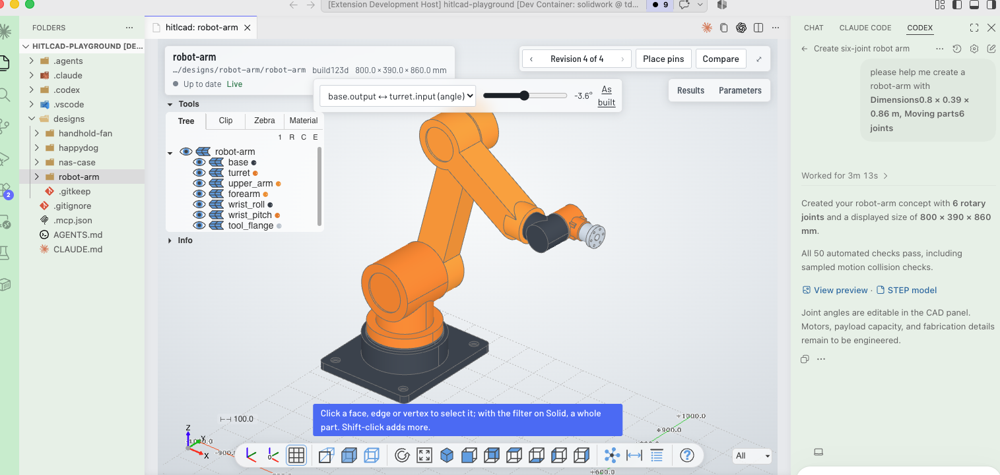
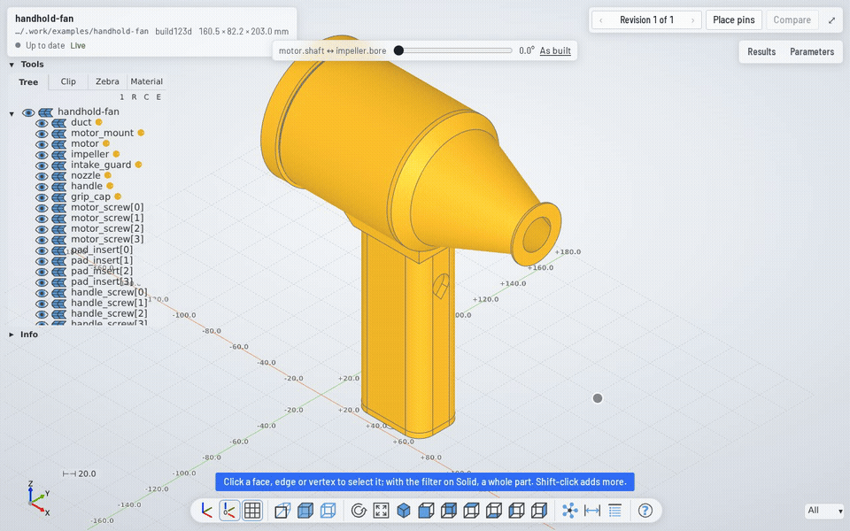
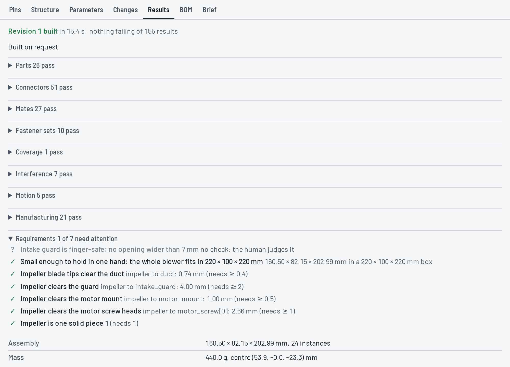
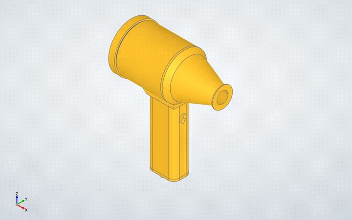
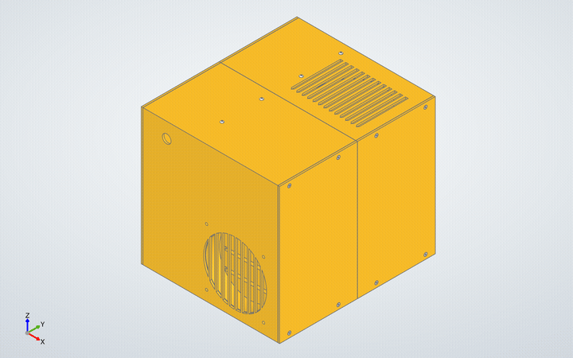
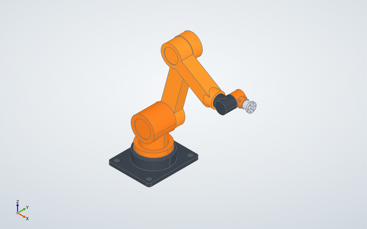
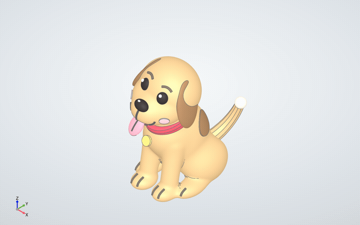
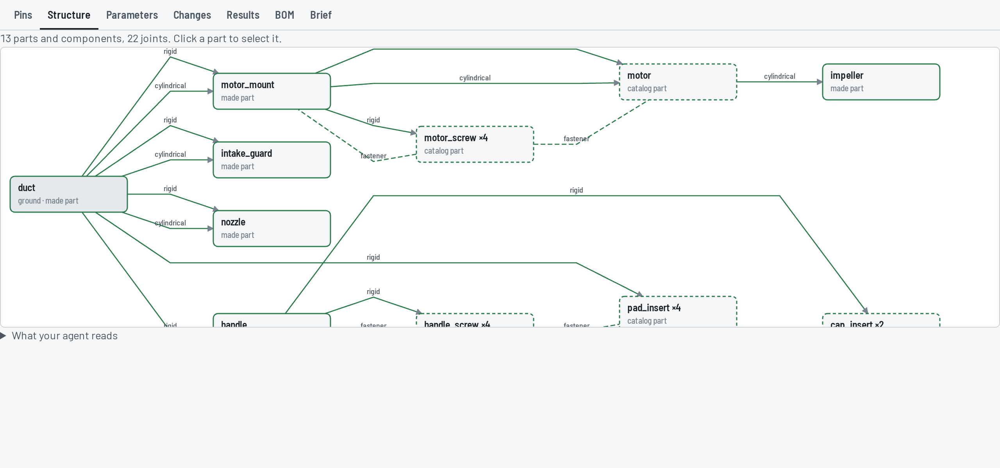

<p align="center">
  <picture>
    <source media="(prefers-color-scheme: dark)" srcset="docs/images/logo-dark.svg">
    
  </picture>
</p>

<p align="center">English · <a href="README.zh-CN.md">简体中文</a></p>

hitlcad is human-in-the-loop CAD. Your coding agent, Claude Code or Codex in VS Code, writes the
CAD as Python. hitlcad builds it every time a file is saved, measures what came out, and shows you
the model in 3D next to the code. You stay in the loop by pointing at the model instead of
describing it: click a face and the agent knows exactly which one, or pin a note to it and the agent
changes the files to match.

<table>
<tr>
<td width="57%"></td>
<td width="43%"></td>
</tr>
</table>

## How you stay in the loop

1. You look at the build in the 3D editor and click **Place pins**, then click the spot on the model
   that should change and write what you want there: *narrow the nozzle to a 20 mm outlet*.
2. Your next message to the agent carries the pin, named by the part and face it sits on, so
   "address my pins" is enough. You don't copy anything over.
3. The agent edits the part's code. Saving rebuilds it and checks the whole assembly again.
4. The pin moves with its part onto the new build. The agent resolves it once it's done, and you
   see the change where you pinned it. Reopen it if it isn't right.

Selecting works the same way without a note: click a face, edge or part, and "make this bore
0.5 mm larger" refers to exactly that. [What the agent receives](#what-a-session-looks-like) is
shown below.

## What a session looks like

Say you ask for *a hand-held blower for dusting my PC: a 750 W brushless motor in a printed duct,
PETG, with a pistol grip*. That is the [handhold-fan](examples/handhold-fan) example.

Before any geometry, the agent writes down what the product is made of and how the pieces go
together. Printed parts get a material, bought parts come from a catalog, and every joint is
declared between named features:

```jsonc
"impeller":     { "role": "axial fan rotor on the motor shaft", "material": "PETG",
                  "connectors": { "bore": { "kind": "hole" } } },
"handle_screw": { "catalog": { "designation": "ISO 4762 M3 × 10" }, ... },

{ "type": "cylindrical", "a": "motor.shaft", "b": "impeller.bore", "fit": { "clearance": [0.0, 0.15] } },
{ "text": "Impeller blade tips clear the duct",
  "check": { "kind": "clearance", "between": ["impeller", "duct"], "min": 0.4 } }
```

Then it writes one Python file per part. Each save rebuilds the parts that changed and checks the
whole assembly again. Agents make mistakes here. Suppose it typed the impeller's diameter in as
70 mm instead of reading it from the parameters. The build comes back with:

```
✗ interference duct+impeller: duct and impeller overlap by 91.11 mm³ in 7 pieces within x 4.00 … 22.00, y -34.20 … 35.00, z -35.00 … 35.00, about 0.25 mm deep (also: motion motor.shaft+impeller.bore, requirement 'Impeller blade tips clear the duct')
? requirement Intake guard is finger-safe: no opening wider than 7 mm: no check: the human judges it
1 problem (2 failing checks), 1 unverified; 130 checks pass
```

That is the text your agent reads after the build: one line per mistake, naming the other checks
it fails, so it fixes the impeller and tries again before you've looked. Pick M3 × 12 screws for a
motor with 6 mm deep holes and the four screws come back as one line, `✗ fastener
motor_screw.seat:motor_mount.motor_screws>motor.screw_holes ×4 at [0, 1, 2, 3]`, that says
`bottoms out: it reaches 8.50 mm past the opening of motor.screw_holes[0], where motor stops it at 6.00`.

Once it builds clean, you look at it. In the clip at the top, you click the duct's mounting bore and
pin a note to the nozzle. Your next message to the agent carries this along:

```
Selected in the 3D view:
1. duct.mount_bore: Cylinder face r=39.42 mm, axis (1.00, 0.00, 0.00), area 17813.0 mm² (face 5 of duct)

Open pins (resolve them with resolve_pins once addressed):
- Cone face, axis (-1.00, 0.00, 0.00), area 8803.8 mm² (face 3 of nozzle): Narrow the nozzle to a 20 mm outlet
```

So "make that bore a bit bigger" means one specific face of one specific part, and the agent knows
which. Pins stay attached to their part when it's rebuilt, until the agent resolves them.

## How much does it check?

For the blower, 134 checks on every build:



Each line below is quoted from that build. When some fail, the tab lists problems first, the same
lines your agent reads: the checks one mistake fails together, a pattern's copies as one.

- **Parts** (26). Every part is a valid solid with a closed mesh.
- **Connectors** (40). Each feature the agent declared is found in the geometry and measured:
  `duct.mount_bore: Ø73.850 × 58.50 deep`.
- **Mates** (27). Joined features line up, and fits are what was asked for after the printer's
  allowance: `fit 0.200 mm (hole Ø73.850, shaft Ø73.500, after process allowances (0.15 hole, 0 shaft)), needs 0.05 … 0.5`.
- **Fastener sets** (10). Each screw seats, clears its hole and bites:
  `motor_screw[0].seat through motor_mount.motor_screws[0] into motor.screw_holes[3]: seated, clears, engages 4.50 mm`.
- **Coverage** (1). Nothing floats: `all 24 instances connect to duct`.
- **Interference** (1). No two parts overlap unless a joint says they should, like a heat-set insert
  melted into the duct; the 6 overlaps joints expect are listed, not counted.
- **Motion** (1). Moving parts are swept through their range:
  `motor.shaft ↔ impeller.bore moves through a full turn without collision (nothing in its reach meets its sweep)`;
  the 4 mates other joints hold still are listed, not counted. What a closed loop of mates moves (a four-bar's
  coupler, a planetary's planets) is checked at every position the solver settles it in; you watch it
  move in the panel to pass it.
- **Manufacturing** (21). Each part is checked against its process in the orientation it's made:
  `duct: thinnest wall 2.49 mm (minimum 0.8 mm)`, overhangs, bed contact. FDM, resin printing, CNC
  milling, sheet metal and injection molding each have their own rules.
- **Requirements** (7). The brief's requirements, measured, through the motion too:
  `impeller to duct: 0.73 mm (needs ≥ 0.4) in a full turn of motor.shaft+impeller.bore`.
  "The intake guard is finger-safe" isn't something a program can settle, so that one is yours.

The [assembly model](docs/assembly-model.md) covers the rest: ISO 286 fits, tolerance stacks, gear
relations, configurations.

## Examples

Each one comes apart into its parts, goes back together, and then shows what the outside hides.

<table>
<tr>
<td width="50%"><a href="examples/handhold-fan"></a></td>
<td width="50%"><a href="examples/nas-case"></a></td>
</tr>
<tr>
<td valign="top"><a href="examples/handhold-fan"><b>Hand-held blower</b></a><br>The blower from the walkthrough: 13 parts around a 750 W motor, 24 instances with the screws and inserts, 134 checks. build123d.</td>
<td valign="top"><a href="examples/nas-case"><b>NAS case</b></a><br>A micro-ATX NAS for four 3.5" drives, printed as nine pieces that each fit a 256 mm bed and held together by 32 M3 screws in heat-set inserts. 97 instances, 435 checks. build123d.</td>
</tr>
<tr>
<td><a href="examples/robot-arm"></a></td>
<td><a href="examples/happydog"></a></td>
</tr>
<tr>
<td valign="top"><a href="examples/robot-arm"><b>Robot arm</b></a><br>The arm Codex builds in the screenshot at the top: seven links on six revolute joints, each swept through its travel for collisions, with a URDF for simulation. 800 × 390 × 860 mm, 51 checks. build123d.</td>
<td valign="top"><a href="examples/happydog"><b>Happy dog</b></a><br>A figurine in its colours, printed in three pieces: the head on a peg whose fit is measured on the mesh, the tail plugged into the rump. Sculpted in Blender, with sliders for head tilt, ear flare and tail wag.</td>
</tr>
</table>

Each one is a folder you can copy into a project's `designs/` and open, or build from a terminal:

```bash
hitlcad build examples/handhold-fan --out build-out
```

## Your agent, your files

When you create a project, Claude Code and Codex get hitlcad's tools and skills, and a hook that
passes along what you select and pin. You keep using them the way you already do.

A design is a plain folder. Commit it and review the agent's changes as diffs:

```
handhold-fan/
  design.json       parts, joints, parameters, requirements, the brief
  interfaces.py     values two parts share, computed once (the bore and the shaft that fits it)
  parts/duct.py     one file per part, modelled in its own frame, the way it's made
  parts/...
  assembly.py       where each part sits
  build/            each part's STEP and STL, and the outputs it asks for; regenerated, git-ignored
```

Each part gets its own STEP and STL for the printer or the machine shop. A design can ask for a
STEP of the whole assembly, which keeps its structure, so it opens in other CAD tools as parts and
sub-assemblies, not one lump; and for a bill of materials, 3MF, and URDF or SDF for a robot.

The panel has more than the clip shows: parameter sliders, comparing any two revisions, the
assembly as a graph, the BOM and the brief.



## Get started

1. Download a [release](https://github.com/blne-team/hitlcad/releases), unpack it and run
   `./install.sh`. [INSTALL.md](INSTALL.md) has the details: requirements, Windows, remote
   workspaces, settings.
2. In VS Code, run **hitlcad: New Design Project** and open the folder it creates.
3. Ask your agent for something to build.

## More

- [INSTALL.md](INSTALL.md): installing, project setup, configuration, troubleshooting
- [docs/assembly-model.md](docs/assembly-model.md): what a design contains and how each part of it
  is checked
- [docs/architecture.md](docs/architecture.md): how hitlcad works inside
- [docs/plugins.md](docs/plugins.md): plugins (hitlcad's own vocabulary is one), and how every error
  reads
- [docs/development.md](docs/development.md): working on hitlcad itself
- [docs/roadmap.md](docs/roadmap.md): what comes next

## License

[MIT](LICENSE)
