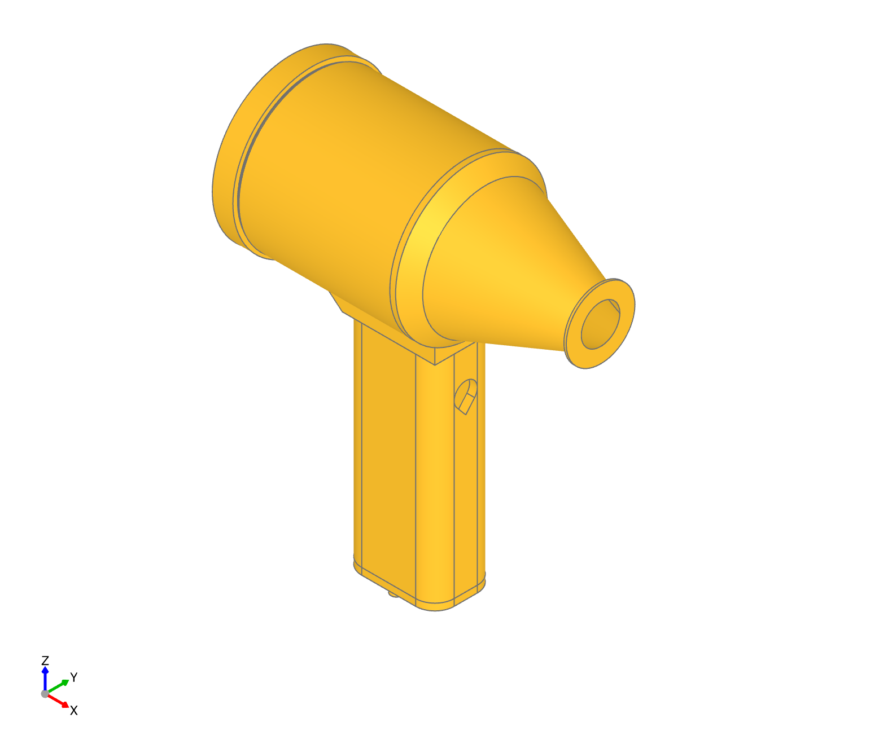
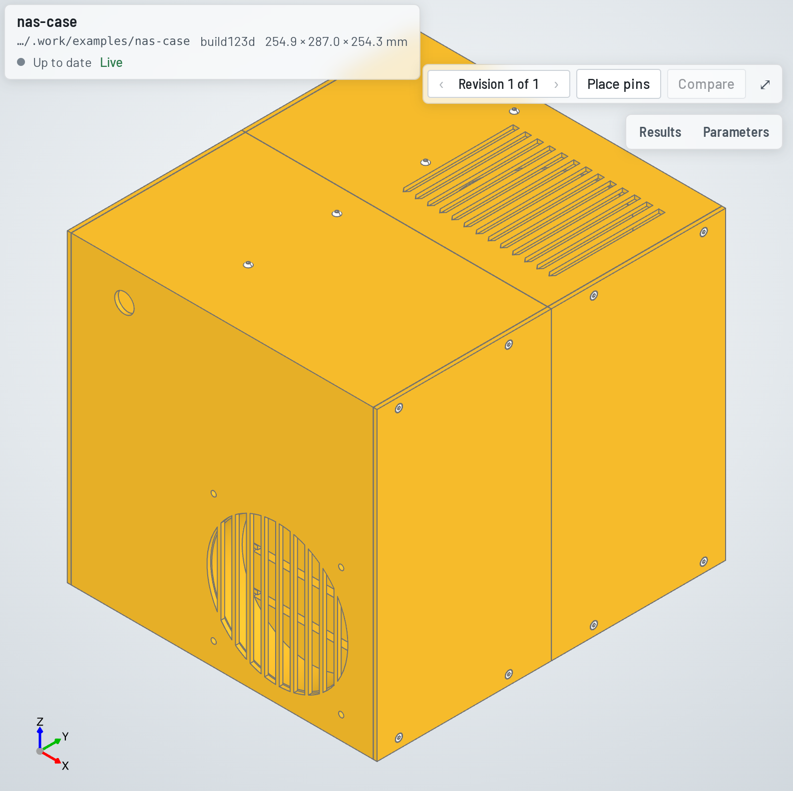
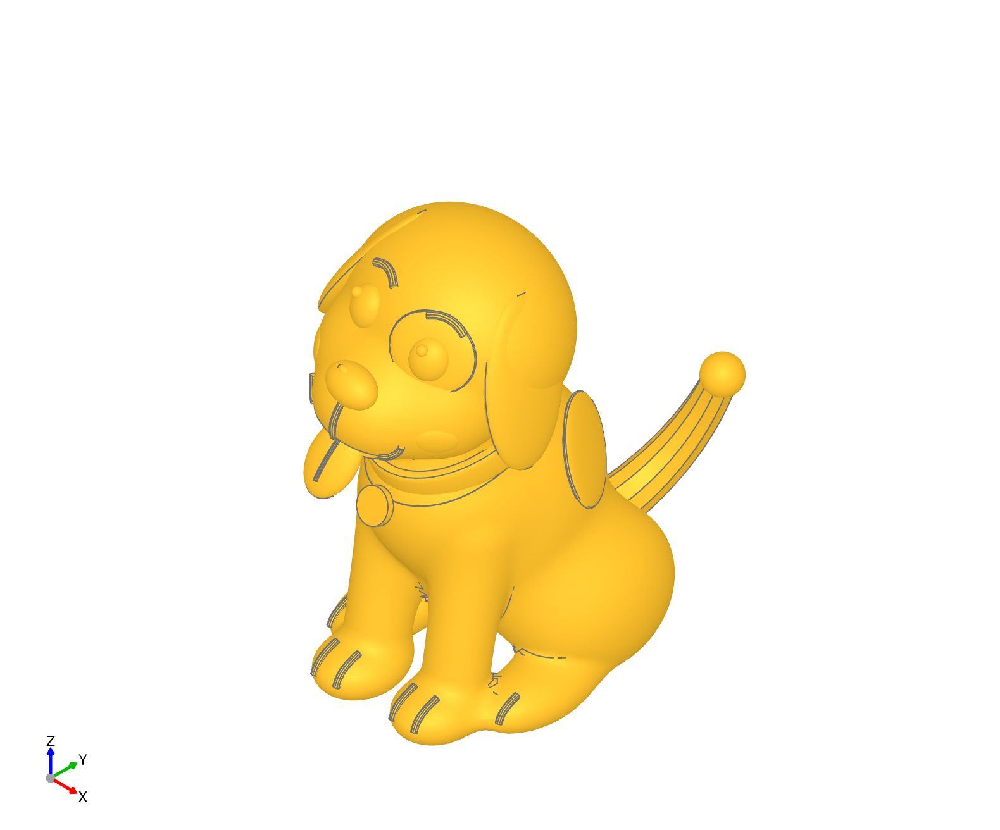

<p align="center">
  <picture>
    <source media="(prefers-color-scheme: dark)" srcset="docs/images/logo-dark.svg">
    
  </picture>
</p>

<p align="center"><a href="README.md">English</a> · 简体中文</p>

hitlcad 是“人在回路”（human-in-the-loop）的 CAD。你的编程智能体，也就是 VS Code 里的 Claude Code 或
Codex，用 Python 写 CAD。每保存一次文件，hitlcad 就构建一次，测量构建出的结果，并把 3D 模型显示在代码旁边。
你留在回路里的方式是直接指着模型，而不是用文字描述它：点一个面，智能体就确切知道是哪一个；在上面钉一条注释，
智能体就会修改文件来满足它。

<table>
<tr>
<td width="57%"></td>
<td width="43%"></td>
</tr>
</table>

## 你如何留在回路里

1. 你在 3D 编辑器里查看构建结果，点击 **Place pins**，再点模型上需要修改的位置，写下你想要的效果：
   *把喷嘴收窄到 20 mm 出口*。
2. 你发给智能体的下一条消息会带上这枚图钉，并注明它所在的零件和面，所以一句“处理我的图钉”就够了。
   不需要复制任何东西。
3. 智能体修改这个零件的代码。保存后重新构建，并再次检查整个装配体。
4. 图钉跟着零件移到新的构建结果上。智能体改完后会把它标为已解决，你在钉的位置就能看到改动。
   不满意可以重新打开它。

不写注释时，选择也是一样：点一个面、一条边或一个零件，“把这个孔加大 0.5 mm”指的就是它。
[智能体收到的内容](#一次会话是什么样子)见下文。

## 一次会话是什么样子

假设你要的是*一个给电脑除尘的手持吹风机：750 W 无刷电机装在打印的风道里，PETG 材料，手枪式握把*。
这就是 [handhold-fan](examples/handhold-fan) 示例。

在建模之前，智能体先写下这个产品由什么组成、各部分如何装在一起。打印件指定材料，外购件从目录里选，
每个连接都声明在两个有名字的特征之间：

```jsonc
"impeller":     { "role": "axial fan rotor on the motor shaft", "material": "PETG",
                  "connectors": { "bore": { "kind": "hole" } } },
"handle_screw": { "catalog": { "designation": "ISO 4762 M3 × 10" }, ... },

{ "type": "cylindrical", "a": "motor.shaft", "b": "impeller.bore", "fit": { "clearance": [0.0, 0.15] } },
{ "text": "Impeller blade tips clear the duct",
  "check": { "kind": "clearance", "between": ["impeller", "duct"], "min": 0.4 } }
```

然后它为每个零件写一个 Python 文件。每次保存都会重建改动过的零件，并再次检查整个装配体。
智能体在这一步会犯错。假设它把叶轮直径直接写成了 70 mm，而没有从参数里读取。构建结果是：

```
✗ interference duct+impeller: duct and impeller overlap by 91.11 mm³
✗ motion motor.shaft+impeller.bore: motor.shaft ↔ impeller.bore at 0.0°: impeller hits duct (91.11 mm³)
✗ requirement Impeller blade tips clear the duct: impeller and duct overlap by 91.1 mm³
✓ 151 of 155 results pass
```

智能体在构建后读到的就是这段文字，所以在你看之前，它就已经修好叶轮重新试过了。如果电机的螺孔只有 6 mm 深，
却选了 M3 × 12 的螺钉，你会看到 `bottoms out: 8.50 mm into a 6.00 mm deep motor.screw_holes[0]`，
每颗螺钉一条。

构建通过之后，轮到你来看。在上面的动图里，你点了风道的安装孔，又在喷嘴上钉了一条注释。
你发给智能体的下一条消息会附带这些内容：

```
Selected in the 3D view:
1. duct.mount_bore: Cylinder face r=39.42 mm, axis (1.00, 0.00, 0.00), area 17813.0 mm² (face 5 of duct)

Open pins (resolve them with resolve_pins once addressed):
- Cone face, axis (-1.00, 0.00, 0.00), area 8803.8 mm² (face 3 of nozzle): Narrow the nozzle to a 20 mm outlet
```

所以“把那个孔稍微加大一点”指的是某个零件上的某一个面，智能体知道是哪一个。零件重建后，图钉仍然留在它上面，
直到智能体把它标为已解决。

## 它检查多少东西？

这个吹风机每次构建检查 155 项：


下面每一行引文都摘自这次构建。

- **零件**（26）。每个零件都是有效的实体，网格是封闭的。
- **连接特征**（51）。智能体声明的每个特征都能在几何体里找到并测量出来：
  `duct.mount_bore: Ø73.850 × 58.50 deep`。
- **配合**（27）。相连的特征对得上，扣除打印机的补偿量后，配合正是要求的那样：
  `fit 0.200 mm (hole Ø73.850, shaft Ø73.500) after process allowances`。
- **紧固件组**（10）。每颗螺钉都能落座、穿过它的孔并咬住螺纹：
  `motor_screw[0].seat through motor_mount.motor_screws[0] into motor.screw_holes[3]: seated, clears, engages 4.50 mm`。
- **连通性**（1）。没有悬空的零件：`all 24 instances connect to duct`。
- **干涉**（7）。任何两个零件都不重叠，除非某个连接说明它们本该重叠，比如热熔进风道的螺母嵌件。
- **运动**（5）。运动件在整个行程内扫一遍：
  `motor.shaft ↔ impeller.bore moves through a full turn (24 positions) without collision`。
- **制造**（21）。每个零件按它的加工工艺、以它的加工朝向检查：
  `duct: thinnest wall 1.48 mm (minimum 0.8 mm)`，还有悬垂和与热床的接触。FDM、光固化打印、CNC 铣削、
  钣金和注塑各有各的规则。
- **需求**（7）。设计说明里的需求，逐条测量：`impeller to duct: 0.74 mm (needs ≥ 0.4)`。
  “进风口护网不会伤到手指”不是程序能判定的，这一条由你来判断。

[装配模型](docs/assembly-model.md)涵盖其余内容：ISO 286 配合、公差累积、齿轮关系、多种配置。

## 示例

<table>
<tr>
<td width="33%"><a href="examples/handhold-fan"></a></td>
<td width="33%"><a href="examples/nas-case"></a></td>
<td width="33%"><a href="examples/happydog"></a></td>
</tr>
<tr>
<td valign="top"><a href="examples/handhold-fan"><b>手持吹风机</b></a><br>上文演示里的吹风机：围绕一台 750 W 电机的 13 个零件，算上螺钉和嵌件共 24 个实例，155 项检查。build123d。</td>
<td valign="top"><a href="examples/nas-case"><b>NAS 机箱</b></a><br>装四块 3.5 英寸硬盘的 micro-ATX NAS，分九块打印，每块都放得进 256 mm 的打印平台，由 32 颗 M3 螺钉拧进热熔嵌件固定。97 个实例，435 项检查。build123d。</td>
<td valign="top"><a href="examples/happydog"><b>开心小狗</b></a><br>带配色的小狗摆件，分三块打印：头插在一根销上，销的配合直接在网格上测量；尾巴插进臀部。在 Blender 里雕刻，有调节头部倾斜、耳朵张开和尾巴摆动的滑块。</td>
</tr>
</table>

每个示例都是一个文件夹，可以复制到项目的 `designs/` 里打开，也可以在终端里构建：

```bash
hitlcad build examples/handhold-fan --out build-out
```

## 你的智能体，你的文件

创建项目时，Claude Code 和 Codex 会得到 hitlcad 的工具和技能（skills），以及一个把你的选择和图钉传给它们的
钩子（hook）。你照常使用它们就行。

一个设计就是一个普通的文件夹。把它提交到 git，以 diff 的形式审查智能体的改动：

```
handhold-fan/
  design.json       零件、连接、参数、需求、设计说明
  interfaces.py     两个零件共用的数值，只算一次（比如孔和与之配合的轴）
  parts/duct.py     每个零件一个文件，在它自己的坐标系里、按它的制造方式建模
  parts/...
  assembly.py       每个零件放在哪里
  build/            STEP、STL、3MF、BOM、渲染图；自动重新生成，不纳入 git
```

STEP 文件保留了装配体的结构，在其他 CAD 软件里打开时是一个个零件和子装配体，而不是一整块。
每个零件还有自己的 STEP 和 STL，可以直接交给打印机或机加工车间。设计还可以要求输出物料清单（BOM）、3MF，
以及机器人用的 URDF 或 SDF。

面板的功能不止动图里那些：参数滑块、任意两个修订版本的对比、以关系图展示的装配体、BOM 和设计说明。


## 开始使用

1. 下载一个 [release](https://github.com/blne-team/solidwork/releases)，解压后运行 `./install.sh`。
   [INSTALL.md](INSTALL.md)（英文）有详细说明：系统要求、Windows、远程工作区、设置。
2. 在 VS Code 里运行 **hitlcad: New Design Project**，然后打开它创建的文件夹。
3. 让你的智能体造点东西。

## 更多

以下文档为英文：

- [INSTALL.md](INSTALL.md)：安装、项目设置、配置、故障排查
- [docs/assembly-model.md](docs/assembly-model.md)：一个设计包含什么，以及每一部分如何检查
- [docs/architecture.md](docs/architecture.md)：hitlcad 的内部原理
- [docs/development.md](docs/development.md)：参与 hitlcad 本身的开发

## 许可证

[MIT](LICENSE)
