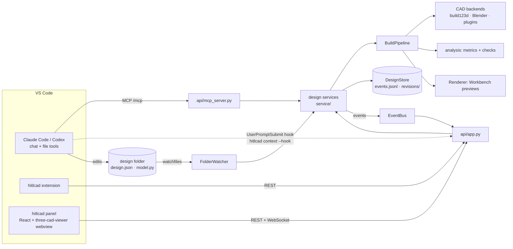

# Architecture

hitlcad adds parametric CAD to the coding agent you already use. Claude Code or Codex, running
in VS Code, writes model code for a CAD kernel. hitlcad builds, measures and renders it. You
review each build in a 3D panel next to the code, select faces, pin notes to the surface and
tune parameters, then keep talking to the agent in its own chat.

hitlcad has no agent loop, chat or approval flow of its own. It provides tools to the agent and
a view to the human, and it moves what the human points at into the agent's context.



## Layers

| Layer | Module | Responsibility | Extension point |
| --- | --- | --- | --- |
| Domain | `core/types.py`, `core/events.py` | Parameters, briefs, `BuildSpec` (everything a build depends on), revisions, selection, pins; requirement checks and manufacturing processes, each a model that verifies or checks itself; the append-only event log and its projection `DesignState` | `RequirementCheck` and `Manufacturing` unions |
| Store | `store/` | Persist design events and revision artifacts | `DesignStore` protocol, wired in `app.py` |
| Design folders | `designs/folder.py`, `designs/watcher.py`, `designs/project.py` | Read/scaffold `design.json` (the agent writes the model source); rebuild on save; scaffold projects with agent config | — |
| CAD backends | `backends/` | Run model source in a child process; emit `mesh.stl` (mm, Z up) plus native files (STEP, .blend) | `CADBackend` / `SubprocessBackend`, entry-point group `hitlcad.backends` |
| Execution | `backends/executor.py` | Run untrusted code with limits | `Executor` protocol (container/bwrap executors) |
| Analysis | `analysis/` | Measure the STL, run checks (including those of the process `design.json` declares under `manufacturing`), measure each `Part` of a build (holes, walls, overlaps and gaps with manifold3d) for the requirement checks, tessellate models for the 3D view (`cadview`), describe what was clicked, query and measure B-rep geometry, carry picks across rebuilds | `CHECKS` in `analysis/mesh.py` |
| Rendering | `render/` | Preview sheet (iso/front/right/top) for the agent and the panel | `Renderer` protocol |
| Pipeline | `pipeline.py` | `BuildSpec` → build → measure → check → verify requirements → 3D view (`view.json`) → render → hashed manifest | — |
| Services | `service/` | `designs.py`: design folders bound to their event logs (open, state, events); `builds.py`: builds on request, after parameter edits and debounced after saves; `feedback.py`: selection and pins, carried across rebuilds; `context.py`: what the agent's hook is told. Never call an LLM | — |
| Agent-facing text | `describe.py` | Build reports, selection and pins as text for agents | — |
| Interfaces | `api/app.py`, `api/mcp_server.py`, `cli.py` | REST and WebSocket event streams for the panel and extension (its OpenAPI schema generates the panel's types, `vscode-extension/ui/src/api/schema.ts`, with `scripts/api-types.sh`), MCP for agents, CLI and hook | — |
| Composition | `app.py` | `HitlCad.create(...)` wires everything from settings; tests swap in their own CAD backends and renderer | — |

## Design folders are the source of truth

A design is any folder holding `design.json` (name, backend, parameters, optional brief) and its
model source (`model.py`, defining `build(p)`). People and agents edit these files with normal
tools and commit them. hitlcad keeps everything machine-local in `<data_dir>`:

- `folders.json` maps folder paths to design ids, so committed files hold no ids.
- `designs/<id>/events.jsonl` is the design's review history: `design_opened`,
  `design_updated` (name, backend, brief), `build_started`, `revision_created`, `error`,
  `selection_changed`, `pins_changed`. `DesignState` is a pure fold of it.
- `designs/<id>/revisions/<n>/` holds each build's outputs (STEP, STL, GLB, preview, log).

Each successful build is also copied to the design folder's `build/`, swapped in whole, so
people and agents can open the files from the workspace. The folder carries its own
`.gitignore` (`*`) and is replaced only when that marker shows hitlcad created it. A failed
build leaves the last good outputs in place.

`FolderWatcher` watches registered folders (`watchfiles`). A change in a design folder syncs
the brief into the log and schedules a debounced rebuild. The rebuild is skipped when the
folder's `BuildSpec` (backend, parameters, source, manufacturing, requirements) hashes the same
as the last build's. Whenever the set of folders changes, and at startup, it builds folders whose
files differ from their latest build: new designs, and edits made while hitlcad was down.
Parameter edits from the panel are written to `design.json` and built at once; the hash check
stops that write from building twice.

## How the agent and the human meet

The agent works in its own chat with its own tools. hitlcad's MCP tools take the design
folder's absolute path:

| Tool | Purpose |
| --- | --- |
| `list_backends` | Choose a kernel |
| `create_design` | Scaffold a design folder and show it in the panel |
| `build_design` | Build now; returns measurements, checks and the preview renders |
| `get_design` | Latest build, brief, selection and open pins |
| `get_feedback` | What the human selected and pinned, with pin ids |
| `resolve_pins` | Mark pins addressed, with a reply the panel shows |
| `get_revision` | Source and report of an earlier revision |
| `list_geometry` | Every face, edge or vertex of a build123d build, numbered as selections number them |
| `measure_geometry` | Distance between two faces, edges, vertices or points, with angle and parallel gap |

The human works in the panel:

Every 3D view (the panel and the model-file viewer) is three-cad-viewer fed by `view.json`:
`cadview` tessellates the build's STEP with ocp-tessellate, keeping faces, edges and vertices,
or `mesh.stl` when there is no STEP (Blender). The viewer brings the part tree, clipping planes,
measurement, zebra stripes and explode; `vscode-extension/ui/src/lib/cadView.ts` is the one adapter that
reaches past its documented API (GPU picking, and pins, selection markers and the compare ghost
drawn into its scene). three-cad-viewer and ocp-tessellate are pinned together.

- **Select**: a click on a STEP-based model names the exact component, e.g. `face 9` of part
  `/Group/model`, which is `faces()[9]` of the STEP in build123d. The server describes it (type,
  radius, axis, normal, area, length) and stores it as the design's selection. With the viewer's
  filter on Solid, a click names the whole part instead (`part lid`: volume, size, centre, drawn as
  its bounding box), carried across rebuilds by name. On meshes the
  click is a point, described by the object it hit and the surface normal: Blender builds also
  export `objects.glb`, the objects under their names, so a click reads "Point on ear_left";
  meshes without names fall back to connected bodies ("body 3 of 5").
- **Pins**: notes on the surface, stored on the server with the component they are on,
  described the same way. They stay open until the agent calls `resolve_pins` or the human
  resolves them.
- **Across rebuilds**: face numbers change when a model is rebuilt, so after each successful
  build `analysis/anchors.py` moves open pins and the selection onto the new build by geometry:
  the same part, the same kind and type of component, the same orientation, nearest the old point within 10% of
  the model's size, and clearly nearer than any other candidate. A pick without such a match
  stays on its revision; the panel and the agent's feedback say it was not found in the latest
  build.
- **Parameters**: written to `design.json`, rebuilt immediately.
- **Compare**: an earlier revision drawn as an X-ray ghost, plus a Changes tab (parameters,
  size, volume, checks, `model.py` diff), all computed in the panel from the stored revisions.
- **Brief**: shown from `design.json`; agents write it.

What the human points at reaches the agent with their next message, the same way for Claude
Code and Codex. With the human's permission (`designs/agents.py`; `hitlcad init` asks on a
terminal or takes `--hooks`/`--codex`, the extension asks in a dialog when it creates a project and
offers it for a project that lacks it), `hitlcad init` writes a `UserPromptSubmit` hook for each: in
`.claude/settings.json` (which also pre-approves the project's `hitlcad` MCP server) and in
`.codex/hooks.json`. With the separate permission for Codex's user config it also adds hitlcad's
MCP server to `~/.codex/config.toml` and trusts the project there (tomlkit, every other line kept),
which is what makes Codex load the project's `.codex/`. Both run `<hitlcad's python> -m hitlcad.cli context --hook <agent> --server
<url>`, so they depend on neither PATH nor environment. On each prompt the hook posts the agent's
working directory and session id to `/api/context/deliveries`, and `ContextFeed.deliver` answers
for every design under that folder:

- **changed** since this session was last told: the selection and open pins in full (labels, pin
  ids, notes, revision), and a `FeedbackDelivered` event records what went to which session;
- **unchanged**: a one-line reminder with the open pin ids, so the context survives the agent
  summarising its history (`get_feedback` repeats the details);
- **cleared** since then: one line saying so, once.

The agent sees the text as context of the prompt; the hook prints nothing when there is nothing to
say and never fails a prompt (a server that is down adds nothing). The panel compares the latest
delivery with the current selection and pins and shows "Sent to Claude Code at 14:02" or "Goes to
your agent with your next message". Codex runs the hook only once the human has also approved it
(`/hooks`), and again after it changes; hitlcad does not write that approval. **Copy for chat** copies `/api/context` (everything
pointed at under each workspace folder, without recording a delivery) plus model-file selections,
to paste into any chat; agents can always call `get_feedback`.

`hitlcad init` also installs hitlcad's skills, in `.claude/skills/` for Claude Code and
`.agents/skills/` for Codex. They are how hitlcad teaches the agent; `CLAUDE.md` and `AGENTS.md`
only point at them and state the rules. `hitlcad/skills/` holds the static ones (the `hitlcad`
workflow skill, with the requirement checks and manufacturing processes filled in from
`core/types.py`), and every enabled backend adds `hitlcad-<backend>` from its `authoring_guide()`.
Skill folders named `hitlcad*` belong to hitlcad: each `init` rewrites changed ones and removes
ones that no longer exist, so re-running it updates a project after an upgrade. The skills also
claim building, exporting and rendering for the hitlcad tools, so generic CAD or Blender skills
the user has installed serve as API reference instead of running their own pipelines.

## The VS Code extension

The extension (`vscode-extension/`) is the only client the human sees. It starts or connects to
`hitlcad serve` and ships the panel UI (`vscode-extension/ui/`: React and three-cad-viewer, built
by Vite into `out/ui/`), which it loads into three kinds of webview: a design's 3D editor tab, its
Design view (pins, parameters, changes, checks, brief) and the model-file viewer. `src/lib/panelHtml.ts`
writes each page: its Content-Security-Policy, the bundled script, which of the three it shows,
and the server's URL as `vscode.env.asExternalUri` gives it, so remote and devcontainer setups work.
The UI calls the REST API and WebSocket streams there directly; the server allows
`vscode-webview://` origins through CORS and hosts no UI of its own. On connecting, the extension
warns once when the server reports another version than its own (e.g. an old `hitlcad serve`
still running after an upgrade), since the UI expects the API of its release.

The Design view is a VS Code webview view (bottom panel by default, movable like any view) that
follows the active design tab. The editor tab and the Design view share UI state (revision on
screen, compare base, pin mode, active pin, tab): each page sends patches to the extension
(`acquireVsCodeApi().postMessage`), and its `DesignUiHub` merges them per design and sends the
result back to both. The extension also adds commands, a status-bar item and agent
configuration. It follows `/api/activity`, a WebSocket of finished builds across all designs.
When a design in the workspace is rebuilt and its panel is not on screen, the extension opens
that panel without taking focus, or notifies, per `hitlcad.autoOpenPanel`. That way builds a
coding agent triggers show up on their own. Project workspaces never contain hitlcad's source.

## Units and frames

All model space is millimetres, Z up, part resting on Z=0. `mesh.stl` is the canonical
measurement mesh. `view.json` and the viewer use the same frame, so selections and pins reach
the agent in the same frame as the STL and build report. Loose glTF files (metres, Y up) are
converted to it when they are opened.

## Model code contract

Model source defines `build(p)` where `p` maps parameter names to values; the backend's
`authoring_guide()` is the contract shown to the agent, as the project's `hitlcad-<backend>` skill. The source comes only from design
folders, written by the user's own coding agent, which can already run code on the machine.
So hitlcad does not police imports. `LocalExecutor` runs each build in a fresh child process
with rlimits, a scrubbed environment and a timeout, but no filesystem or network isolation.
Use a container executor before exposing the service beyond a single trusted user.

## Adding a CAD backend

Subclass `SubprocessBackend` (or `CADBackend`), write an entry script that honours the
`model.py` + `job.json` → `result.json` protocol and produces `mesh.stl` (and a STEP if it has one), give it
an `authoring_guide()`, and register a factory:

```toml
[project.entry-points."hitlcad.backends"]
openscad = "my_pkg.openscad:factory"   # factory(settings) -> CADBackend
```

Then enable it with `HITLCAD_BACKENDS='["build123d","blender","openscad"]'`.

## Adding a requirement check or a manufacturing process

A requirement check is one model in `core/types.py`: subclass `_OnPart` (or `_Check` for a check
between parts), give it a `kind` literal, an `example` and a docstring, implement `verify(build)`
with what `Part` measures, and add it to the `RequirementCheck` union. A manufacturing process is
the same with `_Process`: a `process` literal, `checks(part)`, and an entry in the `Manufacturing`
union. The `hitlcad` skill lists them from those unions, and
`scripts/api-types.sh` brings them to the panel.
