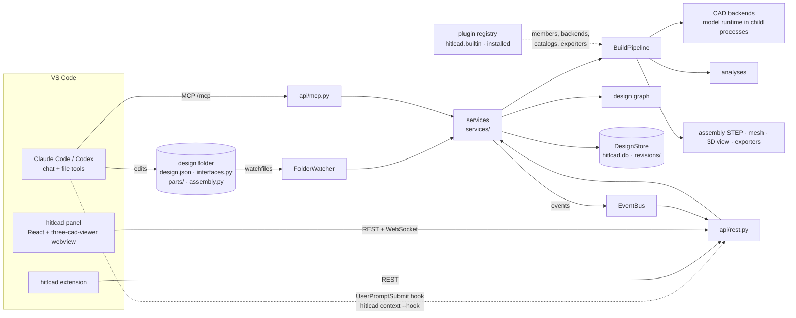

# Architecture

hitlcad adds parametric CAD assemblies to the coding agent you already use. Claude Code or Codex,
running in VS Code, declares a product's structure and writes the code that builds its parts.
hitlcad builds, verifies, measures and renders it. You review each build in a 3D panel next to the
code, select faces, pin notes to the surface and tune parameters, then keep talking to the agent in
its own chat.

hitlcad has no agent loop, chat or approval flow of its own. It provides tools to the agent and a
view to the human, and it moves what the human points at into the agent's context. What a design
is (parts, connectors, mates, relations, fastener sets, components, configurations) is specified
in [assembly-model.md](assembly-model.md); this document is how the system around it works.

## Layers

Each package imports only the packages below it, and packages on one line import neither each other;
`uv run lint-imports` checks it (`pyproject.toml`), and that nothing but the plugin registry reaches
hitlcad's own plugins (`builtin/`).

| Layer | Package | Responsibility | Extension point |
| --- | --- | --- | --- |
| Surfaces | `cli.py`, `api/`, `app.py` | `rest.py`: REST and WebSocket streams for the panel and extension (its OpenAPI schema generates the extension's and the panel's types, `vscode-extension/src/lib/schema.ts`, with `scripts/api-types.sh`). `mcp.py`: the agents' tools. `cli.py`: the CLI and the prompt hook. `app.py`: `HitlCad.create(...)` wires everything from `Settings`; tests swap in their own backends, renderer, analyses and exporters | — |
| Services | `services/` | `designs.py`: folders bound to event logs, revisions read when asked for, where-used. `builds.py`: builds on request, after parameter edits and debounced after saves; configurations; structure checks; dependents. `watcher.py`: saves to builds. `feedback.py`: selection and pins, carried across rebuilds. `explore.py`: the graph with staleness, revision comparisons. `context.py`: what the agent's hook is told. `bus.py`: design events to live subscribers. Never call an LLM | — |
| Workspace, store | `workspace/`, `store/` | `folder.py`: a design folder and its files. `project.py`: scaffolding a project. `agents.py`: the agents' hooks and Codex's config. `store/`: the SQLite database of folders, events, revisions and results in the data folder | `DesignStore` protocol |
| Build | `build/` | `pipeline.py`: the build (below). `cache.py`: part files by their recorded reads. `assemble.py`: the assembly as STEP product structure, as one mesh, as the instanced 3D view, and as the tree a backend writes its own assembly file from | — |
| Agent, review, preview | `agent/`, `review/`, `render/` | `agent/`: what the agent reads. `graph.py`, the design graph: a projection of design.json, the latest build report and the review state, answering in the address grammar, with impact. `describe.py`: picks described, the guides generated from the installed members, the playbook from the error catalog. `sections.py`: section views through failing joints. `skills/`: the skills a project gets. `review/`: what the human points at. `selection.py`: picks described. `anchors.py`: picks and pins carried across rebuilds. `measure.py`: every face, edge and vertex of a build, and the distances between them. `render/`: the preview sheet (iso/front/right/top), in Blender | `Renderer` protocol |
| Analysis | `analysis/` | `base.py`: the `Analysis` protocol, the stages analyses run at, results. `model.py`: the built design (parts, placements, components, connector frames, bodies). The analyses, each looping over what a design declares and asking each member to verify itself: `structure.py`, `checks.py` (parts, connectors, manufacturing, requirements), `mates.py`, `relations.py`, `fasteners.py`, `coverage.py`, `interference.py`, `motion/` (what moves, the exact sweep about fixed axes, loops swept at a solver's positions) | `Analysis` protocol, through plugins |
| Measuring toolkit, backends, exporters | `geometry/`, `backends/`, `exporters.py` | `geometry/`: `mesh.py` (loading and measuring meshes), `features.py` (a part's features, on its B-rep or its mesh: one interface, two adapters), `walls.py` (wall thickness), `brep.py` (B-rep items described), `cadview.py` (the 3D view, written the same way for builds and loose model files, which open as parts with their features). `backends/`: `base.py`, `subprocess_backend.py`: child processes that plan (interface values, placements) and build part files, exporting each part in its own frame (STL, a STEP on B-rep backends) with its connector frames; `registry.py`: the backends `HITLCAD_BACKENDS` enables, of those plugins give. `exporters.py`: the `Exporter` protocol; exporters run per design by `outputs` | `CADBackend` / `SubprocessBackend`, `Exporter`, through plugins |
| Execution | `execution/` | `executor.py`: run untrusted code under a deadline and a memory limit; nothing it starts outlives it. A build process is started before its job and waits for it on stdin, so one kept started (`warm_builds`) takes the next build. `runtime.py`: runs a design's code (`interfaces.py`, part files, `assembly.py`) with `p` and `i` in the build process, evaluates interface values lazily, records what each piece of code read, and writes what went wrong as diagnostics; standard library only, so every backend's Python runs it | `Executor` protocol |
| Settings | `config.py` | `Settings` (environment `HITLCAD_*`) | — |
| Domain | `core/`, `catalogs.py`, `materials.py` | `core/`: `types.py`: parameters, briefs, picks, pins. `structure.py`: what a connector kind, a mate type and a relation type are (`Connector`, `Mate`, `Relation`), components, fits, fastener sets, verification tolerances. `checks.py`: what a requirement check and a manufacturing process are (`Check`, `Process`). `design.py`: design.json format 2, its unions made of the members plugins give, parts, requirements. `report.py`: build spec, results and the problems they add up to, report, revisions. `address.py`: the address grammar. `frames.py`: 4 × 4 frames and the measurements mates make. `iso286.py`: ISO 286 fits. `events.py`: the event log and its projection `DesignState`. `loops.py`: a closed loop of motion as a solver gets it, the check of every position it gives, and the `Solver` protocol. `catalogs.py`: the `CatalogProvider` protocol and the search across providers. `materials.py`: density, processes, minimum thread engagement, from the plugins' `materials.json` files; projects extend it with their own | members, providers, materials, through plugins |
| Kernel, model SDK | `kernel/`, `sdk/` | `kernel/`: `model.py`, the base of every model; `errors.py`, diagnostics (a code, its owner, a message, where), the catalog of their kinds with each one's usual fix, and how each surface presents them; `plugins.py`, the plugin hooks and the registry that gathers what plugins contribute. `sdk/`: what model code imports (`mate_to`, `CatalogPart`); it imports nothing | `ErrorKind`, the `hitlcad.plugins` entry-point group |
| Built-in plugins | `builtin/` | hitlcad's own, registered as any installed plugin is: `joints` (frame, face, hole and shaft connectors; the mate types), `gears` (the gear connector; gear, rack and screw relations), `checks` (requirement checks), `processes` (the five processes and their checks), `build123d` and `blender` (the backends), `catalogs` (bd_warehouse and vendor STEP), `exports` (BOM, 3MF), `robot` (URDF, SDF), `materials`. Nothing else in hitlcad imports it | — |

## Design folders are the source of truth

A design is any folder holding `design.json` and its code (layout and format:
[assembly-model.md](assembly-model.md)). People and agents edit these files with normal tools and
commit them. hitlcad keeps everything machine-local in `<data_dir>`:

- `hitlcad.db`, one SQLite database (`store/sqlite.py`):
  - `folders` maps folder paths to design ids, so committed files hold no ids.
  - `events` is each design's review history: `design_opened`, `design_updated` (name, backend,
    brief), `build_started`, `revision_created`, `error`, `selection_changed`, `pins_changed`,
    `feedback_delivered`. `DesignState` is a pure fold of it. A revision's event lists it
    (`RevisionInfo`: its status, tally, what a failed build failed on).
  - `revisions` holds each revision in full (what it built from and its report), read when asked
    for: opening a design reads none of them. `results` holds their results, so what a revision
    failed is a query (the build summary's "Same as revision 6").
  - A database of another layout is set aside whole (`hitlcad.<time>.db`) and a new one started; a
    design's history that does not read is set aside on its own.
- `hitlcad.lock`, held by the server that keeps the folder: a second server on it refuses to start.
- `designs/<id>/revisions/<n>/` holds each build, self-contained: its sources (`src/`), each part
  in its own frame (`parts/`), each component's own build (`components/<name>/`, the same layout),
  the assembly (`model.step`, `mesh.stl`, `model.blend`), the 3D view (`view.json`), the preview,
  the exporters' files, `build.log` and `report.json`. `build.pipeline.load_built` reads such a
  directory back into the model the analyses saw, so a revision reopened later answers picks and
  geometry questions exactly as it did when it was built.
- `cache/parts/` holds part files' outputs by the inputs they read, `cache/components/` component
  builds by their specs, `cache/results/` costly analysis results (overlaps) by what they depend on.

Each successful build of a design's default configuration is copied to the folder's `build/`,
swapped in whole, so people and agents can open the files from the workspace. The folder carries
its own `.gitignore` (`*`) and is replaced only when that marker shows hitlcad created it. A failed
build leaves the last good outputs in place.

`FolderWatcher` watches registered folders recursively (`watchfiles`), ignoring `build/` and editors'
temporary files. A change schedules a debounced rebuild of the design whose folder holds it. The
rebuild is skipped when the folder's `BuildSpec` (design.json without the brief, the code, the
vendor files' checksums, the components' specs, the installed plugins' versions) hashes the same as the
last build's. A design that
builds schedules the designs that use it as a component; their specs include its own, so they
rebuild only when it changed. Whenever the set of folders changes, and at startup, it builds folders
whose files differ from their latest build. Parameter edits from the panel are written to
`design.json` and built at once; the hash check stops that write from building twice.

## Builds

`BuildPipeline.run(spec, folder, out_dir)`:

1. **Sources.** The code from the spec, and the vendor files, checked against their checksums.
2. **Plan.** The design's backend evaluates every interface value and runs `assembly.py`: the
   placements, before any geometry. Unknown names placed fail the build here.
3. **Components.** Each component placed is built as its own design with the values its parent
   binds (from the plan's interface values), cached by its bound spec, and copied into
   `components/<name>/`.
4. **Part files.** Each part file is looked up in the part cache: its key hashes the file, the
   `lib/` modules it imported, the values of the parameters and interface values it read, and its
   backend's fingerprint (entry script, runtime, mesh tolerances). The rest are built in parallel
   child processes (`build_workers`), files of one backend shared out among them. A file that
   fails is reported with its line; the others still build, and the build fails as a whole.
5. **The built design.** Parts, placements, components, then every connector measured on its part.
6. **Analyses.** Each `Analysis`, at its stage, returns `Result`s naming the kind of check (its
   code) and the addresses they are about. A structure error met by one analysis is reported as a
   structure result; a member's own code that raises (a plugin's check or process) is an unverified
   `plugin.error` result, and the rest of the build goes on; a bug in an analysis is an unverified
   `hitlcad.bug` result.
7. **Outputs.** Part files, the assembly STEP (when every part is B-rep), the mesh, the instanced
   3D view (each part tessellated once, drawn per instance at `/<design>/<instance path>`, mesh
   parts in their materials' colours), the preview, the exporters `outputs` names, and the assembly
   in the own format of each backend that built parts (`CADBackend.write_assembly`: Blender's
   `model.blend`, assembled from the parts' files in one more Blender process, alongside the rest).
8. **Report.** Results, parts (with their reads and measured connectors), instances, components'
   reports, interface values, mass properties, ranges of motion, the bill of materials, artifacts.

A build fails only when the design's files cannot produce geometry (design.json does not validate,
an error in the code, an unknown name placed, a component that fails, a build process that runs out
of time or memory). It is a revision like any other, and its results say why, each with its code and
where in the files (`parts/lid.py line 31`). Everything else (a mate whose frames disagree, a fit out
of range, a collision, a requirement missed) is a failing result of a build that succeeded, which the
agent and the human read and fix. What stops a build that is not the design's to fix (a backend
missing, a plugin missing, a bug) is raised: the tool answers with its diagnostic, and the panel shows
it as the design's error. How each error reads, and whose it is, is in [plugins.md](plugins.md).

## How the agent and the human meet

The agent works in its own chat with its own tools. hitlcad's MCP tools take the design folder's
absolute path, and every name a tool answers with can be passed back to a tool:

| Tool | Purpose |
| --- | --- |
| `list_backends` | Backends, materials, catalog providers and exporters |
| `create_design` | Scaffold a design folder and show it in the panel |
| `search_catalog` | Standard parts: designation, the call that makes it, sizes, connectors |
| `build_design` | Build and verify; `scope="structure"` checks design.json, the interfaces and the placements in seconds, `scope="<address>"` answers about one part; `configuration` builds one variant or `"all"`. Failures first, with section views through failing joints |
| `explore_design` | The design graph: the overview, or one part, instance, component, connector, mate, relation, fastener set, parameter or interface value (with its impact), configuration or revision |
| `compare_revisions` | What changed: parameters, file diffs, results that changed status, parts rebuilt, size and mass |
| `list_geometry` | Every face, edge or vertex of a part (its own frame) or instance (placed), numbered as picks name them |
| `measure_geometry` | Distance, angle and parallel gap between any two addresses: B-rep components, instances, parts, connector frames, points |
| `resolve_pins` | Mark pins addressed, with a reply the panel shows |

The human works in the panel. Every 3D view is three-cad-viewer fed by the instanced view format;
`vscode-extension/ui/src/lib/cadView.ts` is the one adapter that reaches past its documented API (GPU
picking; pins, selection markers, the compare ghost and the motion preview drawn into its scene).
three-cad-viewer and ocp-tessellate are pinned together.

- **Select**: a click on a B-rep instance names the exact component, e.g. `face 9 of lid[0]`, which
  is `faces()[9]` of the lid's STEP, placed; when that face is a connector's feature, the label
  says so (`lid.screws[2]`). With the viewer's filter on Solid, a click names the whole instance.
  On mesh parts a click is a point on the instance, on the object it hit when the part names its
  objects.
- **Pins**: notes on the surface, stored with the instance and connector they are on. They stay
  open until the agent calls `resolve_pins` or the human resolves them.
- **Across rebuilds** (`review/anchors.py`): a pick keeps its instance path; a pick on a
  connector's feature keeps that connector; any other face, edge or vertex is matched by geometry
  in its part's own frame (same kind and type, same orientation, nearest within reach, clearly
  nearer than any other; thresholds in settings); a mesh point moves to the nearest point of the
  same instance. A pick without a match stays on its revision; the panel and the agent say so.
- **Tabs**: Pins; Structure (the design graph, laid out with dagre, coloured by results);
  Parameters (written to `design.json` and rebuilt) with configurations; Changes (against any
  earlier revision, with an X-ray ghost); Results (every analysis, the parts, components, renders
  and files); BOM; Brief.
- **Motion**: each reported range of motion gets a slider that moves what it moves in the view: about
  fixed axes, or a loop through its solved positions, which the human can mark as watched.

What the human points at reaches the agent with their next message, the same way for Claude Code
and Codex. With the human's permission (`workspace/agents.py`; `hitlcad init` asks on a terminal or
takes `--hooks`/`--codex`, the extension asks in a dialog when it creates a project and offers it for
a project that lacks it), `hitlcad init` writes a `UserPromptSubmit` hook for each. The hook names
this machine's interpreter, so it goes where only this machine reads it: Claude Code's per-user
`.claude/settings.local.json` in the project (kept out of the repository by the project's
`.gitignore`), and Codex's user `~/.codex/hooks.json`, as Codex has no per-user file for one project
(the hook adds nothing in a folder without designs). The committed `.mcp.json` and
`.claude/settings.json` (which pre-approves the project's `hitlcad` MCP server) name only the
server's URL. Nor does the project commit an interpreter for VS Code's Python: the extension sets
hitlcad's (`Capabilities.python`) for the workspace through the Python extension's API, which keeps it
in that user's state of the workspace. With the separate permission for Codex's user config it also adds hitlcad's MCP
server to `~/.codex/config.toml` (tomlkit, every other line kept). Both hooks run `<hitlcad's
python> -m hitlcad.cli context --hook <agent> --server <url>`, so they depend on neither PATH nor
environment. On each
prompt the hook posts the agent's working directory and session id to `/api/context/deliveries`,
and `ContextFeed.deliver` answers for every design under that folder:

- **changed** since this session was last told: the selection and open pins in full (labels in the
  address grammar, pin ids, notes, revision), and a `FeedbackDelivered` event records what went to
  which session;
- **unchanged**: a one-line reminder with the open pin ids, so the context survives the agent
  summarising its history (`explore_design` repeats the details);
- **cleared** since then: one line saying so, once.

The hook prints nothing when there is nothing to say and never fails a prompt (a server that is
down adds nothing). The panel compares the latest delivery with the current selection and pins and
shows "Sent to Claude Code at 14:02" or "Goes to your agent with your next message". Codex runs the
hook only once the human has also approved it (`/hooks`). **Copy for chat** copies `/api/context`
plus model-file selections, to paste into any chat.

`hitlcad init` also installs hitlcad's skills, in `.claude/skills/` for Claude Code and
`.agents/skills/` for Codex. They are how hitlcad teaches the agent; `CLAUDE.md` and `AGENTS.md`
only point at them and state the rules. The `hitlcad` skill (structure first, catalog first,
interfaces once, one part file at a time) has its reference sections generated from the installed
members: connector kinds, mate and relation types, fastener sets, requirement checks and processes,
each from its docstring and example. Its `playbook.md` lists every code a build or a tool answers
with, and its usual fix, from the error catalog; plugins add reference files under `reference/`.
Every enabled backend adds `hitlcad-<backend>` from its `authoring_guide()`. Skill folders named `hitlcad*` belong to hitlcad: each `init` rewrites changed
ones and removes ones that no longer exist. The skills also claim building, exporting and rendering
for the hitlcad tools, so generic CAD or Blender skills the user has installed serve as API
reference instead of running their own pipelines.

## The VS Code extension

The extension (`vscode-extension/`) is the only client the human sees. It starts or connects to
`hitlcad serve` and ships the panel UI (`vscode-extension/ui/`: React, three-cad-viewer and dagre,
built by Vite into `out/ui/`), which it loads into three kinds of webview: a design's 3D editor
tab, its Design view (the tabs above) and the model-file viewer. `src/lib/panelHtml.ts` writes each
page: its Content-Security-Policy, the bundled script, which of the three it shows, and the
server's URL as `vscode.env.asExternalUri` gives it, so remote and devcontainer setups work. The UI
calls the REST API and WebSocket streams there directly; the server allows `vscode-webview://`
origins through CORS and hosts no UI of its own. On connecting, the extension warns once when the
server reports another version than its own, since the UI expects the API of its release.

The Design view is a VS Code webview view (bottom panel by default, movable like any view) that
follows the active design tab. The editor tab and the Design view share UI state (revision and
configuration on screen, compare base, pin mode, active pin, tab): each page sends patches to the
extension (`acquireVsCodeApi().postMessage`), and its `DesignUiHub` merges them per design and
sends the result back to both. The extension also adds commands, a status-bar item and agent
configuration. It follows `/api/activity`, a WebSocket of finished builds across all designs. When
a design in the workspace is rebuilt and its panel is not on screen, the extension opens that panel
without taking focus, or notifies, per `hitlcad.autoOpenPanel`. Project workspaces never contain
hitlcad's source.

## Units and frames

All model space is millimetres, Z up. Each part is built in its own frame, the way it is made (a
printed part stands as it prints, on Z=0); `assembly.py` places instances in the design's frame,
and a component's instances sit in its placement's frame. Picks, pins, measurements and the
assembly mesh are in the design's frame; `build/parts/<part>.*` and manufacturing checks are in
the part's. Loose glTF files (metres, Y up) are converted to millimetres, Z up, when they are opened.

## Extension points

Adding a member or a provider changes nothing else: the pipeline, the graph, the address grammar and
the tools present any member's results.

Every extension is a plugin: a module registered under the `hitlcad.plugins` entry-point group,
with `hookimpl` functions (`kernel/plugins.py`). hitlcad's own are plugins too (`builtin/`), so each
of them is a worked example; so is [examples/plugins/hitlcad-lasercut](../examples/plugins/hitlcad-lasercut),
a plugin outside hitlcad. What each hook takes, and what core asks of each member, is in
[plugins.md](plugins.md).

- **A CAD backend** (`hitlcad_backends`, a factory by name): subclass `SubprocessBackend` with an
  `entry` script that loads what it needs and runs `execution/runtime.run` with a `plan` mode (via
  `runtime.plan` and a function turning the kernel's placements into 4 × 4 matrices) and a `parts`
  mode (export each part's STL, and STEP if it has one, with its connector frames), give it an
  `authoring_guide()` and a `command()`, set `brep`; enable it with `HITLCAD_BACKENDS`. To also write
  the assembly in its own format, override `write_assembly` (Blender's runs an `assembly` mode).
- **A connector kind, mate type or relation type** (`hitlcad_connectors`, `hitlcad_mates`,
  `hitlcad_relations`): a `Connector`, `Mate` or `Relation` subclass with a literal discriminator, a
  docstring, an `example`, and its `measure` / `verify` / `ratio`; a round feature says which
  (`round`), and a connector names the faces that are its feature (`owns`).
- **A requirement check or a manufacturing process** (`hitlcad_checks`, `hitlcad_processes`): a
  `Check` (or `OnTarget`) subclass with `verify(build)` and a `hint`, a `Process` subclass with
  `checks(body)`, `allowance` and its `findings` (each one's title and usual fix). Their kinds of
  result enter the error catalog with them.
- **An analysis of a new kind** (`hitlcad_analyses`): an object with `name`, `stage`, `title`,
  `summary` (the panel shows them) and `run(ctx) -> list[Result]`. A result that another analysis may
  report too names their shared `cause` (`core.report.Cause`). Cache costly results with `ctx.cache`.
- **A catalog provider** (`hitlcad_catalogs`, and its module as a model package): helpers that
  return `sdk.CatalogPart`s and an object with `name`, `usage` and `search(query, limit)`.
- **An exporter** (`hitlcad_exporters`): an object with `name`, `title` (the panel's label for its
  files), `summary` and `export(built, report, out_dir)`.
- **Materials** (`hitlcad_materials`): a `materials.json`; a project adds its own beside its designs.
- **Code part files import** (`hitlcad_model_packages`): building blocks, catalog helpers.
- **Error kinds and skill references** (`hitlcad_error_kinds`, `hitlcad_skill_references`): the
  kinds of a plugin's own diagnostics, and reference files for the agents' `hitlcad` skill.

## Safety

Model code comes only from design folders, written by the user's own coding agent, which can
already run code on the machine. So hitlcad does not police imports. `LocalExecutor` runs each
build process under a deadline and a memory limit (the resident memory of the process and all it
started, sampled with psutil), and ends everything it started when it finishes, is stopped or is
cancelled: a process group on POSIX, a job object on Windows. It inherits the server's environment
and provides no filesystem or network isolation. Use a container executor
before exposing the service beyond a single trusted user.

The server has no authentication, so it checks where each request is addressed:
`TrustedHostMiddleware` admits the loopback names and the host of `base_url`, and rejects the rest
(a page that rebinds its own domain to 127.0.0.1 would otherwise call the API as its own origin,
which CORS does not stop). The MCP SDK applies the same rule to `/mcp`.
