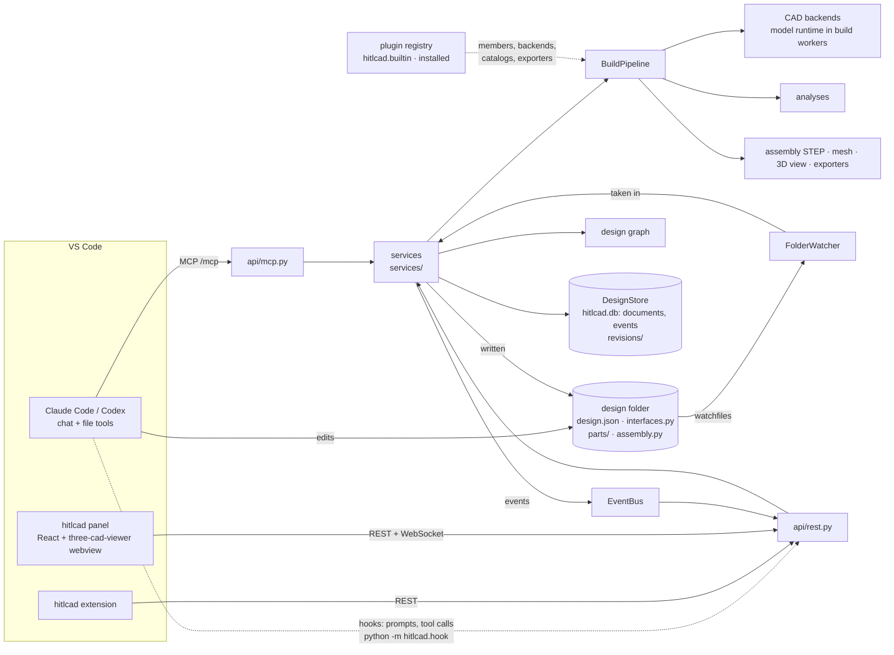

# Architecture

hitlcad adds parametric CAD assemblies to the coding agent you already use. Claude Code or Codex,
running in VS Code, declares a product's structure and writes the code that builds its parts.
hitlcad builds, verifies, measures and renders it. You review each build in a 3D panel next to the
code, select faces, pin notes to the surface and tune parameters, then keep talking to the agent in
its own chat.

hitlcad has no agent loop, chat or approval flow of its own. It provides tools to the agent and a
view to the human, and it moves what the human points at into the agent's context. What a design
is (parts, connectors, mates, relations, fastener sets, components, configurations) is specified
in [assembly-model.md](assembly-model.md); this document is how the system around it works.

## Layers

Each package imports only the packages below it, and packages on one line import neither each other;
`uv run lint-imports` checks it (`pyproject.toml`), and that nothing but the plugin registry reaches
hitlcad's own plugins (`builtin/`).

| Layer | Package | Responsibility | Extension point |
| --- | --- | --- | --- |
| Surfaces | `cli.py`, `api/`, `app.py` | `rest.py`: REST and WebSocket streams for the panel and extension (its OpenAPI schema generates the extension's and the panel's types, `vscode-extension/src/lib/schema.ts`, with `scripts/api-types.sh`). `mcp.py`: the agents' tools. `cli.py`: the CLI. `hook.py`: the agents' hook, on the standard library alone. `app.py`: `HitlCad.create(...)` wires everything from `Settings`; tests swap in their own backends, renderer, analyses and exporters | — |
| Services | `services/` | `designs.py`: designs bound to their folders, documents and event logs; every edit (`change`), the panel's Undo and Redo (`revert`) and every write to a folder (`take_in`); revisions read when asked for, where-used. `documents.py`: each design's document, versions replayed, edits merged from the version they were made on, the folder written. `builds.py`: builds on request, after parameter and outputs edits, Undo and Redo, and debounced after changes, each announcing its progress and the results found so far; configurations; structure checks; dependents. `watcher.py`: writes to the folders taken in, then built. `sessions.py`: the agents' hooks: what their tools write taken in as theirs, and what they are told. `feedback.py`: selection and pins, carried across rebuilds. `revisions.py`: the builds' files, kept by the builds something needs, made again when another is opened, and loaded back as the analyses saw them. `explore.py`: the graph with staleness, revision comparisons. `context.py`: what the human points at, as the agent's hook tells it. `bus.py`: design events to live subscribers. Never call an LLM | — |
| Workspace, store | `workspace/`, `store/` | `document.py`: a design's files as one CRDT document (pycrdt), its snapshots, span edits of design.json (tree-sitter-json), edits that crossed. `folder.py`: a design folder, its build spec from a snapshot, build/. `project.py`: scaffolding a project. `agents.py`: the agents' hooks and Codex's config. `store/`: the SQLite database of folders, documents, events, revisions and results in the data folder | `DesignStore` protocol |
| Build | `build/` | `pipeline.py`: the build (below). `cache.py`: part files by their recorded reads. `assemble.py`: the assembly as STEP product structure, as one mesh, as the instanced 3D view, and as the tree a backend writes its own assembly file from | — |
| Agent, review, preview | `agent/`, `review/`, `render/` | `agent/`: what the agent reads. `graph.py`, the design graph: a projection of design.json, the latest build report and the review state, answering in the address grammar, with impact. `describe.py`: picks described, the guides generated from the installed members, the playbook from the error catalog. `sections.py`: section views through failing joints. `skills/`: the skills a project gets. `review/`: what the human points at. `selection.py`: picks described. `anchors.py`: picks and pins carried across rebuilds. `measure.py`: every face, edge and vertex of a build, and the distances between them. `render/`: the preview sheet (iso/front/right/top), in Blender | `Renderer` protocol |
| Analysis | `analysis/` | `base.py`: the `Analysis` protocol, the stages analyses run at, results. `model.py`: the built design (parts, placements, components, connector frames, bodies). The analyses, each looping over what a design declares and asking each member to verify itself: `structure.py`, `checks.py` (parts, connectors, manufacturing, requirements), `mates.py`, `relations.py`, `fasteners.py`, `coverage.py`, `interference.py`, `motion/` (`plans.py`: the inputs and each one's stages; `path.py`: an input's positions, traced through its blocks; `sweep.py`: the one collision sweep, exact or at the positions traced; `findings.py`: what a sweep finds, its first contacts, least gaps and the pairs it leaves out; `turning.py`: what of a solid is round about an axis, so a sweep moves only the rest) | `Analysis` protocol, through plugins |
| Measuring toolkit, backends, exporters | `geometry/`, `backends/`, `exporters.py` | `geometry/`: `mesh.py` (loading and measuring meshes), `features.py` (a part's features, on its B-rep or its mesh: one interface, two adapters), `walls.py` (wall thickness), `sampling.py` (surface patches for sampling), `brep.py` (B-rep items described), `cadview.py` (the 3D view: part views and the scenes that place them, the same for builds and loose model files, which open as parts with their features). `backends/`: `base.py`: a backend, whose workers plan (interface values, placements) and build part files, exporting each part in its own frame (STL, GLB, a STEP on B-rep backends, and its view) with its connector frames; `workers.py`: a backend's build workers, each one design's, kept between its builds; `registry.py`: the backends `HITLCAD_BACKENDS` enables, of those plugins give. `exporters.py`: the `Exporter` protocol; exporters run per design by `outputs` | `CADBackend` and its worker's `runtime.Adapter`, `Exporter`, through plugins |
| Execution | `execution/` | `executor.py`: run a process to its end under a deadline (the renderer's); nothing it starts outlives it. A `Worker` is a process that runs untrusted code job after job, each under its deadline and a memory limit holding all the worker holds. `runtime.py`: runs a design's code (`interfaces.py`, part files, `assembly.py`) with `p` and `i` in a build worker, evaluates interface values lazily, records what each piece of code read, and writes what went wrong as diagnostics; and serves the worker's jobs (`serve`), dropping the design's modules after each and keeping what it exported by the shape's content; standard library only, so every backend's Python runs it | `Executor` protocol |
| Settings | `config.py` | `Settings` (environment `HITLCAD_*`) | — |
| Domain | `core/`, `catalogs.py`, `materials.py` | `core/`: `types.py`: parameters, briefs, picks, pins. `structure.py`: what a connector kind, a mate type and a relation type are (`Connector`, `Mate`, `Relation`), components, fits, fastener sets, verification tolerances. `checks.py`: what a requirement check and a manufacturing process are (`Check`, `Process`). `design.py`: design.json format 2, its unions made of the members plugins give, parts, requirements. `report.py`: build spec, results and the problems they add up to, report, revisions. `address.py`: the address grammar. `frames.py`: 4 × 4 frames and the measurements mates make. `iso286.py`: ISO 286 fits. `events.py`: the event log and its projection `DesignState`. `laws.py`: how far one coordinate moves as another does (gears, racks, screws, cams), which keeps a sweep about fixed axes exact. `loops.py`: a block of motion as a solver gets it (one CasADi graph), the check of every position, and the `Solver` protocol. `catalogs.py`: the `CatalogProvider` protocol and the search across providers. `materials.py`: density, processes, minimum thread engagement, from the plugins' `materials.json` files; projects extend it with their own | members, providers, materials, through plugins |
| Kernel, model SDK | `kernel/`, `sdk/` | `kernel/`: `model.py`, the base of every model; `errors.py`, diagnostics (a code, its owner, a message, where), the catalog of their kinds with each one's usual fix, and how each surface presents them; `plugins.py`, the plugin hooks and the registry that gathers what plugins contribute. `sdk/`: what model code imports (`mate_to`, `CatalogPart`); it imports nothing | `ErrorKind`, the `hitlcad.plugins` entry-point group |
| Built-in plugins | `builtin/` | hitlcad's own, registered as any installed plugin is: `joints` (frame, face, hole and shaft connectors; the mate types), `gears` (the gear connector; gear, rack and screw relations), `checks` (requirement checks), `processes` (the five processes and their checks), `build123d` and `blender` (the backends), `catalogs` (bd_warehouse and vendor STEP), `exports` (BOM, 3MF), `robot` (URDF, SDF), `materials`. Nothing else in hitlcad imports it | — |

## The database holds the design; the folder is its copy

A design is any folder holding `design.json` and its code (layout and format:
[assembly-model.md](assembly-model.md)). hitlcad keeps a design's files as one CRDT document in its database
(`workspace/document.py`, pycrdt): design.json and the Python files as text, every other file by its content
(sha256). The folder is the document's copy on disk: people and
agents read it, edit it with their own tools and commit it, and hitlcad merges what they write into the
document and writes the merge back. Builds, the panel and the agent's tools read the document, never the folder.

**One write path.** Every edit is made on a version of the document and merged into the current one
(`DesignService.change`), so what others changed since is kept:

| Writer | Edits from | How |
| --- | --- | --- |
| The panel (parameters, outputs) | the version the revision on screen built (`Revision.version`) | the value's own span in design.json (tree-sitter-json), every other character as it was |
| The panel's Undo and Redo | the version of the step it takes back | the files that step changed, made as they were before it |
| An editor's save (VS Code, through the extension) | the version the buffer was read at: the extension says, just before the save, what the buffer was read from (`POST /api/files/saving`) | what the folder holds, taken in |
| Anyone else writing the folder (an agent's tool, git) | each file from the version it was last written or read at: what its writer found on disk | what the folder holds, taken in: after an agent's tool, as the agent's (its hooks: `services/sessions.py`); otherwise by the watcher and before every build |

Writes to the folder are taken in by `FolderWatcher` (`watchfiles`, ignoring `build/`, `.git`, caches and
editors' temporary files), and before every build, so a build asked for right after a save builds what was
saved; while an agent's tool that can write a design runs, the watcher leaves it to that tool. A server that
starts takes in every registered design's folder before it serves, so nothing reads a design behind what was
written while no server ran (a design builds once it is opened). An edit is made on the files of the version it
started from and merged into the current ones by a three-way merge of each file, by tokens (`document.merge`:
string literals, comments, numbers, words), so a value is changed whole; the folder is then written file by
file, atomically, never over a file that changed on disk since it was last read (that write is taken in next). A
design's edits and take-ins run one at a time, so a folder read while an edit merged is never taken for a write
that undid it. An edit that changed nothing makes no version. A design whose folder is moved or renamed is found
again where it is opened next, when its files there are exactly its own (`design_moved`), with its history,
revisions and pins.

**Edits that crossed.** What two edits change in different places is all kept, as are insertions both made at
one place; where both changed the same tokens otherwise (the same value set to 5 and to 6), the edit merged
later is kept. hitlcad refuses neither: it records where (`edits_crossed`: the file, the line, the line as
merged, whose edits), the Design view shows it until the human dismisses it, and the agent's hook tells the
session it involves. The human looks at what the merge kept.

**No save step.** The folder is the document's copy: an edit, the panel's included, reaches it as soon as it
merges (while an agent's turn writes the design, when the turn ends), and a write to it is taken in as it lands,
so the agents, git and the human's editor read the design the panel shows. What the human does in the panel is committed by one deliberate act, one edit and one version:
Rebuild after setting parameters, ticking an output, and for drags and dimensions on the model the end of the
gesture (the drag released, the value entered), which the panel previews until then without writing.

**Undo and Redo.** The human takes back their own panel edits in the panel (the editor's ↶ and ↷, Ctrl+Z and
Ctrl+Shift+Z outside text fields, ⌘ on macOS): an Undo is made on the version of the edit it takes back, the files
that edit changed made as they were before it, and merged into the current one, so what agents and saves wrote
since stays; a Redo takes back an Undo the same way, and a new panel edit leaves nothing to redo. The design's
state lists both (`undo`, `redo`; `DocumentChanged.reverts` names the step a change took back). A request names
the step it takes back, so a second click never takes back one the human has not seen (`request.not_undoable`);
an Undo is a step even when what it takes back is gone already. Agents' and others' edits are taken back where
they were made: their tools, git.

hitlcad keeps everything machine-local in `<data_dir>`:

- `hitlcad.db`, one SQLite database (`store/sqlite.py`):
  - `folders` maps folder paths to design ids, so committed files hold no ids.
  - `doc_updates` holds each design's document as the updates that made it, one per version, with its
    origin (`folder`, `scaffold`, `panel`, `agent:<agent>:<session>`, `disk`); `doc_snapshots` the whole
    document every 100 versions, so an earlier version replays from near it; `blobs` other files' contents
    by their sums.
  - `events` is each design's history: `design_opened`, `design_updated` (name, backend, brief),
    `document_changed` (a version, its origin, the files it changed, the panel's summary), `edits_crossed`,
    `revision_created`, `error`, `selection_changed`, `pins_changed`, `feedback_delivered`.
    `DesignState` is a pure fold of it, with the latest document version and its recent changes. A revision's
    event lists it (`RevisionInfo`: its status, tally, what a failed build failed on, the version it built).
    The build running (`build_progress`: the revision it makes, its scene once shown, what it does now;
    `build_stopped` when newer files replace it) is live only: applied to the state and sent to the
    streams, never kept, so a server that stops mid-build starts again with none running.
  - `revisions` holds each revision (what it built from and its report), read when asked for: opening a
    design reads none of them. What it built from is kept by reference (`BuiltFrom`): the version of each
    design folder's files it read, its own and its components', with hitlcad's default tolerances and the
    plugins' versions; its build spec is made again from those, by the same `DesignFolder.spec` the build
    made it with, so a revision keeps no copy of the files. `results` holds their results, so what a revision
    failed is a query (the build summary's "Same as revision 6").
  - A database of another layout is set aside whole (`hitlcad.<time>.db`) and a new one started (its
    designs' documents start again from their folders); a design's history that does not read is set aside
    on its own.
- `hitlcad.lock`, held by the server that keeps the folder: a second server on it refuses to start.
- `designs/<id>/revisions/<n>/` holds a build's files: each part in its own frame (`parts/`, hard links to the
  part cache's files, so a part takes its room once however many builds hold it), each component's own build
  (`components/<name>/`, the same layout, linked from the component cache), the 3D view (`scene.json`), the
  outputs design.json names (the assembly's `model.step`, `mesh.stl`, `model.blend`, the preview, the exporters'
  files) and `build.log`. The code a build runs is written beside them while it runs, with its vendor files by
  their sums from the database, and removed after; its report is the database's. Only the builds something needs
  keep their files (`RevisionFiles.prune`, after each build): the latest successful build of each configuration,
  and those the open pins, the selection and the watched motions are on. Any other is made again when it is
  opened (`RevisionFiles.files`, `BuildPipeline.restore`: its parts from the part cache, its scene and outputs;
  its analyses are its report's). `build.pipeline.load_built` reads such a directory back into the model the
  analyses saw, so a revision reopened later answers picks and geometry questions as it did when it was built.
  hitlcad never commits: git is the human's history of the design folder.
- `cache/parts/` holds part files' outputs by the inputs they read, `cache/components/` component
  builds by their specs, `cache/results/` costly analysis results by what they depend on: overlaps by
  the two parts and where one sits from the other (so a subassembly moved whole is not measured again),
  motion traces and sweeps, and each part's manufacturing findings. In memory, the server keeps each
  part's loaded geometry (`analysis.model.Shapes`: its mesh, solid, B-rep features, metrics and
  colliders, `loaded_parts` of them) by its files' content, shared by every build and every revision
  loaded back whose part has the same files.

Each successful build of a design's default configuration is copied to the folder's `build/`,
swapped in whole, so people and agents can open the files from the workspace. The folder carries
its own `.gitignore` (`*`) and is replaced only when that marker shows hitlcad created it. A failed
build leaves the last good outputs in place.

A change to a design's document schedules a debounced rebuild. The rebuild is skipped when the
`BuildSpec` (design.json without the brief, the code, the vendor files' checksums, those of the files its
requirement checks read (`Check.files`: reference pictures), the components' specs, the installed plugins'
versions) hashes the same as the last build's. A build of other files than the one running for the same design
and configuration supersedes it: the running one stops at its next stage (after the plan, after the part files,
between analyses, before the outputs), its part files still waiting for a worker dropped and those running
finished into the part cache, which the newer build then takes them from; a caller waiting on the superseded
build gets the newer one's revision. A design that builds schedules the designs that use it as a component;
their specs include its own, so they rebuild only when it changed. A design whose folder changed while the
server was down takes it in, and builds, the first time a panel or an agent opens it, not at startup: the
server knows every design it ever opened, and most of them nobody is looking at. `hitlcad build` (the CLI,
outside the server) builds a folder as it is on disk.

## Builds

`BuildPipeline.run(spec, folder, out_dir)`:

1. **Sources.** The code from the spec, and the vendor files, checked against their checksums.
2. **Plan.** The design's backend evaluates every interface value and runs `assembly.py`: the
   placements, before any geometry. Unknown names placed fail the build here.
3. **Components.** Each component placed is built as its own design with the values its parent
   binds (from the plan's interface values), cached by its bound spec, and copied into
   `components/<name>/`. A binding reads only the parent's plan, never another component, so the
   components build all at once, and beside the part files (step 4), which read only the plan too;
   each runs to its end before a failure or a newer build stops the build, so what it built is cached.
4. **Part files.** Each part file is looked up in the part cache: its key hashes the file, the
   `lib/` modules it imported, the values of the parameters and interface values it read, and its
   backend's fingerprint (entry script, runtime, mesh tolerances). The rest are built in the
   design's build workers, a job per file, in parallel (`workers`); a worker keeps what it loaded and
   exported between the design's builds (see [plugins.md](plugins.md#build-workers)). A file that
   fails is reported with its line; the others still build, and the build fails as a whole.
5. **The built design.** Parts, placements, components. Its 3D view's scene (`scene.json`: each
   part's view, which its backend tessellated where it built it, drawn per instance at
   `/<design>/<instance path>`, mesh parts in their materials' colours) is written now, and the panel
   draws the revision being built from it while the rest runs (`build_progress`), its picks waiting
   for the revision. Then every connector is measured on its part.
6. **Analyses.** Each `Analysis`, at its stage, returns `Result`s naming the kind of check (its
   code) and the addresses they are about. The stages put cause before effect: where results share
   a cause, the earliest analysis's lead the problem. Each analysis's results reach the panel as it
   finishes (`build_progress`, grouped into problems as the report groups them), into the build on
   screen. A structure error met by one analysis is reported as a structure result; a member's own
   code that raises (a plugin's check or process) is an unverified `plugin.error` result, and the
   rest of the build goes on; a bug in an analysis is an unverified `hitlcad.bug` result.
7. **Outputs.** What design.json `outputs` names, all at once (`BuildPipeline.export`): the build's
   own (`step`, the assembly STEP; `stl`, its mesh; `native`, the assembly in the own format of each
   backend that built parts, `CADBackend.write_assembly`, Blender's `model.blend` assembled from the
   parts' files in one more Blender process; `preview`, the rendered views) and the exporters'. One
   the design cannot have (a STEP of an assembly with mesh parts) is a failing `output.unavailable`
   result. Review needs none of them: every build writes only the sources, the parts' own files and
   the 3D view besides.
8. **Report.** Results, parts (with their reads and measured connectors), instances, components'
   reports, interface values, mass properties, ranges of motion, the bill of materials, artifacts,
   and how long each step took (`durations`: the plan, components, part files, the scene, measuring
   connectors, each analysis, the report, the outputs).

A build fails only when the design's files cannot produce geometry (design.json does not validate,
an error in the code, an unknown name placed, a component that fails, a build process that runs out
of time or memory). It is a revision like any other, and its results say why, each with its code and
where in the files (`parts/lid.py line 31`). Everything else (a mate whose frames disagree, a fit out
of range, a collision, a requirement missed) is a failing result of a build that succeeded, which the
agent and the human read and fix. What stops a build that is not the design's to fix (a backend
missing, a plugin missing, a bug) is raised: the tool answers with its diagnostic, and the panel shows
it as the design's error. How each error reads, and whose it is, is in [plugins.md](plugins.md).

## How the agent and the human meet

The agent works in its own chat with its own tools. hitlcad's MCP tools take the design folder's
absolute path, and every name a tool answers with can be passed back to a tool:

| Tool | Purpose |
| --- | --- |
| `list_backends` | Backends, materials, catalog providers and outputs |
| `create_design` | Scaffold a design folder and show it in the panel |
| `search_catalog` | Standard parts: designation, the call that makes it, sizes, connectors |
| `build_design` | Build and verify; `scope="structure"` checks design.json, the interfaces and the placements in seconds, `scope="<address>"` answers about one part; `configuration` builds one variant or `"all"`. Up to five grouped problems by default; `include_images=true` adds previews, joint sections and requirement figures |
| `explore_design` | A compact overview, or one part, instance, component, connector, mate, relation, fastener set, parameter or interface value (with its impact), configuration or revision. `focus="review"` returns all selections and open pins; `include_images=true` adds views from an existing build |
| `compare_revisions` | What changed: parameters, file diffs, results that changed status, parts rebuilt, size and mass |
| `list_geometry` | Every face, edge or vertex of a part (its own frame) or instance (placed), numbered as picks name them |
| `measure_geometry` | Distance, angle and parallel gap between any two addresses: B-rep components, instances, parts, connector frames, points |
| `resolve_pins` | Mark pins addressed, with a reply the panel shows |

The human works in the panel. Every 3D view is three-cad-viewer fed by a scene: its instanced format,
whose instances name part view files (`geometry.cadview.PartView`, binary arrays the panel reads where
they lie) instead of carrying their buffers. `vscode-extension/ui/src/lib/scene.ts` loads a scene and
keeps the part views it has read by digest, up to 256 MB, so a part unchanged since the last revision
is neither fetched nor read again; `cadView.ts` is the one adapter that reaches past the viewer's
documented API (GPU picking; pins, selection markers, the compare ghost and the motion preview drawn
into its scene). hitlcad tessellates B-rep and mesh parts itself (`geometry/cadview.py`), into the
shapes three-cad-viewer draws; the viewer is pinned, and its shape format checked when it is upgraded.

- **Select**: a click on a B-rep instance names the exact component, e.g. `face 9 of lid[0]`, which
  is `faces()[9]` of the lid's STEP, placed; when that face is a connector's feature, the label
  says so (`lid.screws[2]`). With the viewer's filter on Solid, a click names the whole instance.
  On mesh parts a click is a point on the instance, on the object it hit when the part names its
  objects.
- **Pins**: notes on the surface, stored with the instance and connector they are on. They stay
  open until the agent calls `resolve_pins` or the human resolves them.
- **Across rebuilds** (`review/anchors.py`): a pick keeps its instance path; a pick on a
  connector's feature keeps that connector; any other face, edge or vertex is matched by geometry
  in its part's own frame (same kind and type, same orientation, nearest within reach, clearly
  nearer than any other; thresholds in settings); a mesh point moves to the nearest point of the
  same instance. A pick without a match stays on its revision; the panel and the agent say so.
- **Tabs**: Pins; Structure (the design graph, laid out with dagre, coloured by results);
  Parameters (merged into `design.json` from the revision on screen, and rebuilt) with configurations; Changes (against any
  earlier revision, with an X-ray ghost); Results (every analysis, each as it finishes while a
  build runs; the parts, components, renders and files, and the outputs each build writes, ticked
  into design.json `outputs` the way parameters are written); BOM; Brief.
- **Motion**: each reported range of motion gets a slider that moves what it moves in the view: about
  fixed axes, or a traced sweep through its solved positions, which the human can mark as watched.
- **Inspection**: a result's `about` addresses identify the parts to highlight and frame. The viewer can
  isolate those parts, fit the selection, section through its centre along X/Y/Z, or restore all parts,
  through Inspect in the bottom toolbox.
  These actions use the shared webview UI state and do not change the design.
- **Measurements**: two selected items are measured on their revision through `review/measure.py`, the
  same geometry service the agent uses. Exact topology gives minimum distances and applicable angles;
  point selections measure the picked points. The user can save the result and a note as an existing
  pin. Its note records the measured revision, so carrying the pin to another build does not present
  the old measurement as a new one. The agent's hook delivers it to the agent.

What the human points at reaches the agent with their next message, and what the human changes reaches it while
it works, the same way for Claude Code and Codex. With the human's permission (`workspace/agents.py`; `hitlcad
init` asks on a terminal or takes `--hooks`/`--codex`, the extension asks in a dialog when it creates a project
and offers it for a project that lacks it), `hitlcad init` writes hitlcad's hook for each, on `UserPromptSubmit`,
on `Stop` (a turn's end) and on `PreToolUse` and `PostToolUse` of the tools that write files (Claude Code's
`Write|Edit|MultiEdit|NotebookEdit|Bash`, with `PostToolUseFailure` too; Codex's `Bash|apply_patch`). The hook
names this machine's interpreter, so it goes where only this machine reads it: Claude Code's per-user
`.claude/settings.local.json` in the project (kept out of the repository by the project's `.gitignore`), and
Codex's user `~/.codex/hooks.json`, as Codex has no per-user file for one project (the hook adds nothing in a
folder without designs). The committed `.mcp.json` and `.claude/settings.json` (which pre-approves the project's
`hitlcad` MCP server) name only the server's URL. Nor does the project commit an interpreter for VS Code's
Python: the extension sets hitlcad's (`Capabilities.python`) for the workspace through the Python extension's
API, which keeps it in that user's state of the workspace. With the separate permission for Codex's user config
it also adds hitlcad's MCP server to `~/.codex/config.toml` (tomlkit, every other line kept). Both hooks run
`<hitlcad's python> -m hitlcad.hook <agent>`, so they depend on neither PATH nor environment, and name no server:
the server says where it listens in `server.json` in its data folder while it serves, so every project's hook is
the same whatever port the server is on. A project's setup counts only when its hooks are as this hitlcad writes
them, so one set up by another version is asked about again. The hook imports the standard library alone and
starts in about 95 ms, since it runs twice around each tool call, and exits 0 whatever goes wrong. It posts what
the agent gave it to `/api/agents/hook`, and `AgentSessions` (`services/sessions.py`) answers:

- **a prompt**: for every design under the agent's working directory, from `ContextFeed.deliver`, what the
  human points at: **changed** since this session was last told, the selection and open pins in full (labels
  in the address grammar, pin ids, notes, revision), and a `FeedbackDelivered` event records what went to
  which session; **unchanged**, a one-line reminder with the open pin ids, so the context survives the agent
  summarising its history (`explore_design` repeats the details); **cleared** since then, one line saying so,
  once. Then what others changed, as after a tool.
- **a tool starting**: the designs it can write (those of the files it names, or every design under the working
  directory for a shell command) are left to it: the watcher does not take them in while it runs. They are the
  turn's from then until it ends (`DesignService.hold`): their folders stay as the agent's tools leave them, so no
  file the agent read changes under it and it need not read one again (a file that changed would cost it the whole
  file again: Claude Code edits none changed since it was read), while what others change merges into the
  design's files, which builds and tools read.
- **a tool ending**, or failing: what the folders hold, taken in as the session's edit, each file from the version
  it was last written or read at, which is what the tool found on disk; then what others (the human in the panel,
  saves to the folder, other sessions) changed in the session's designs since it was last told, with the lines
  each change made (`DocumentChanged.lines`, the first five), and where its edits crossed theirs, as context added
  to the tool's result. A session is told only of what happens after it is first seen.
- **a turn ending** (`Stop`): the designs it held get their folders written, merged, and rebuild once, whole, not
  after each file; a build the agent or the panel asks for does not wait. A tool that never ends (the human
  denied it) ends with the turn, or with the session's next prompt.

The hook prints nothing when there is nothing to say and never fails a prompt or a tool (a server that is
down adds nothing). The panel compares the latest delivery with the current selection and pins and
shows "Sent to Claude Code at 14:02" or "Goes to your agent with your next message". Codex runs the
hook only once the human has also approved it (`/hooks`). **Copy for chat** copies `/api/context`
plus model-file selections, to paste into any chat.

`hitlcad init` also installs hitlcad's skills, in `.claude/skills/` for Claude Code and
`.agents/skills/` for Codex. They are how hitlcad teaches the agent; `CLAUDE.md` and `AGENTS.md`
only point at them and state the rules. MCP instructions give a short workflow. The `hitlcad` skill
(structure first, catalog first, interfaces once, one part file at a time) links to
`reference/design-json.md`, generated from the installed
members: connector kinds, mate and relation types, fastener sets, requirement checks and processes,
each from its docstring and example, and loaded when needed. Installing these files does not add
their full contents to each prompt. Its `playbook.md` lists every code a build or a tool answers
with, and its usual fix, from the error catalog; plugins add reference files under `reference/`.
Every enabled backend adds `hitlcad-<backend>` from its `authoring_guide()`. Skill folders named `hitlcad*` belong to hitlcad: each `init` rewrites changed
ones and removes ones that no longer exist. The skills also claim building, exporting and rendering
for the hitlcad tools, so generic CAD or Blender skills the user has installed serve as API
reference instead of running their own pipelines.

The companion skills `hitlcad-design`, `hitlcad-form`, `hitlcad-dfm` and `hitlcad-style` teach general
CAD judgment: intent and concept exploration, composition, manufacture/assembly, and six initial
visual directions. Each has Agent Skills YAML frontmatter and an actionable `SKILL.md`; optional
references and complete teaching designs are loaded only when relevant. They use the existing tools
according to the question being resolved and keep the operating/backend contracts. Their examples
are packaged text assets, copied into a design folder before building through hitlcad. Distribution
and real example builds are tested; improved design quality still needs behavioral benchmarking.

The format follows the [Agent Skills specification](https://agentskills.io/specification): discovery
metadata in YAML, instructions in Markdown and supporting files loaded on demand. Method review
included [AgentCAD's canonical guide](https://github.com/jdilla1277/agentcad/blob/52af472ddade4b26d8b0d47f304ac5f9f6183d53/src/agentcad/guide.py)
(edit-preservation requirements and independent acceptance evidence),
[Anthropic's frontend-design skill](https://github.com/anthropics/skills/tree/main/skills/frontend-design)
(direction grounded in the brief), and
[svg-creator](https://github.com/upbrew-tech/svg-creator-skill) (visual feedback during construction).
The locally installed `build123d-cad`, `bpy` and `blender-skill` also informed modeling and inspection
guidance. These reviews produced original instructions adapted to hitlcad; upstream source and
standalone runners are not bundled or required. In particular, external unit conventions, injected
APIs, fixed radius rules and validation shortcuts do not replace the installed backend contracts.

## The VS Code extension

The extension (`vscode-extension/`) is the only client the human sees. It starts or connects to
`hitlcad serve` and ships the panel UI (`vscode-extension/ui/`: React, three-cad-viewer and dagre,
built by Vite into `out/ui/`), which it loads into three kinds of webview: a design's 3D editor
tab, its Design view (the tabs above) and the model-file viewer. `src/lib/panelHtml.ts` writes each
page: its Content-Security-Policy, the bundled script, which of the three it shows, and the
server's URL as `vscode.env.asExternalUri` gives it, so remote and devcontainer setups work. The UI
calls the REST API and WebSocket streams there directly; the server allows `vscode-webview://`
origins through CORS and hosts no UI of its own. On connecting, the extension warns once when the
server reports another version than its own, since the UI expects the API of its release.

The Design view is a VS Code webview view (bottom panel by default, movable like any view) that
follows the active design tab. The editor tab and the Design view share UI state (revision and
configuration on screen, compare base, pin mode, active pin, tab): each page sends patches to the
extension (`acquireVsCodeApi().postMessage`), and its `DesignUiHub` merges them per design and
sends the result back to both. The extension also adds commands, a status-bar item and agent
configuration. It follows `/api/activity`, a WebSocket of finished builds across all designs. When
a design in the workspace is rebuilt and its panel is not on screen, the extension opens that panel
without taking focus, or notifies, per `hitlcad.autoOpenPanel`. Project workspaces never contain
hitlcad's source.

## Units and frames

All model space is millimetres, Z up. Each part is built in its own frame, the way it is made (a
printed part stands as it prints, on Z=0); `assembly.py` places instances in the design's frame,
and a component's instances sit in its placement's frame. Picks, pins, measurements and the
assembly mesh are in the design's frame; `build/parts/<part>.*` and manufacturing checks are in
the part's. Loose glTF files (metres, Y up) are converted to millimetres, Z up, when they are opened.

## Extension points

Adding a member or a provider changes nothing else: the pipeline, the graph, the address grammar and
the tools present any member's results.

Every extension is a plugin: a module registered under the `hitlcad.plugins` entry-point group,
with `hookimpl` functions (`kernel/plugins.py`). hitlcad's own are plugins too (`builtin/`), so each
of them is a worked example; so is [examples/plugins/hitlcad-lasercut](../examples/plugins/hitlcad-lasercut),
a plugin outside hitlcad. What each hook takes, and what core asks of each member, is in
[plugins.md](plugins.md).

- **A CAD backend** (`hitlcad_backends`, a factory by name taking the settings): subclass `CADBackend`
  with an `entry` script that loads what it needs and serves jobs with `runtime.serve(adapter)`, its
  `runtime.Adapter` saying how the backend's part values read and export; give it an
  `authoring_guide()` and a `command()`, set `brep`; enable it with `HITLCAD_BACKENDS`. To also write
  the assembly in its own format, override `write_assembly` (Blender's runs an `assembly` mode). See
  [plugins.md](plugins.md#what-a-backend-gives).
- **A connector kind, mate type or relation type** (`hitlcad_connectors`, `hitlcad_mates`,
  `hitlcad_relations`): a `Connector`, `Mate` or `Relation` subclass with a literal discriminator, a
  docstring, an `example`, and its `measure` / `verify` / `ratio`; a round feature says which
  (`round`), and a connector names the faces that are its feature (`owns`).
- **A requirement check or a manufacturing process** (`hitlcad_checks`, `hitlcad_processes`): a
  `Check` (or `OnTarget`) subclass with `verify(build)` and a `hint`, a `Process` subclass with
  `checks(body)`, `allowance` and its `findings` (each one's title and usual fix). Their kinds of
  result enter the error catalog with them.
- **An analysis of a new kind** (`hitlcad_analyses`): an object with `name`, `stage`, `title`,
  `summary` (the panel shows them) and `run(ctx) -> list[Result]`. A result that another analysis may
  report too names their shared `cause` (`core.report.Cause`). Cache costly results with `ctx.cache`.
- **A catalog provider** (`hitlcad_catalogs`, and its module as a model package): helpers that
  return `sdk.CatalogPart`s and an object with `name`, `usage` and `search(query, limit)`.
- **An exporter** (`hitlcad_exporters`): an object with `name`, `title` (the panel's label for its
  files), `summary` and `export(built, report, out_dir)`; an output design.json `outputs` names. The
  names `step`, `stl`, `native` and `preview` are the build's own.
- **Materials** (`hitlcad_materials`): a `materials.json`; a project adds its own beside its designs.
- **Code part files import** (`hitlcad_model_packages`): building blocks, catalog helpers.
- **Error kinds and skill references** (`hitlcad_error_kinds`, `hitlcad_skill_references`): the
  kinds of a plugin's own diagnostics, and reference files for the agents' `hitlcad` skill.

## Safety

Model code comes only from design folders, written by the user's own coding agent, which can
already run code on the machine. So hitlcad does not police imports. `LocalExecutor` runs each
job under a deadline and each build worker under a memory limit (the resident memory of the process
and all it started, sampled with psutil), and ends everything a worker started when the worker ends,
is stopped or is cancelled: a process group on POSIX, a job object on Windows. A worker is one
design's, so no design's code runs where another's ran. It inherits the server's environment
and provides no filesystem or network isolation. Use a container executor
before exposing the service beyond a single trusted user.

The server has no authentication, so it checks where each request is addressed:
`TrustedHostMiddleware` admits the loopback names and the host of `base_url`, and rejects the rest
(a page that rebinds its own domain to 127.0.0.1 would otherwise call the API as its own origin,
which CORS does not stop). The MCP SDK applies the same rule to `/mcp`.
