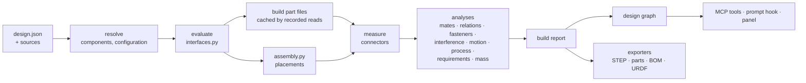

# Assembly model

Status: proposal, not implemented. It replaces outright today's single `model.py`, its
`{name: shape}` return, `design.json` format 1 and the MCP tools that read them (see
[What changes](#what-changes)). There is no migration path.

This document fixes the model and the architecture for the full scope of real products. It is
built in phases ([Roadmap](#roadmap)). Phase 1 fixes the shapes everything else extends:
addresses, the folder layout, the design graph, the build report and the extension unions.
Later phases add members to those unions and fields to those records. None of them reshapes
what an earlier phase built.

## Why

Today a design is one `model.py` whose `build(p)` returns a shape or a dict of named shapes placed
in world coordinates. How the parts relate exists only in that code. In the gearbox test model, the
bolt circle shared by housing and lid is a local variable. The motor, bearing, screws and inserts
it is built around are not in the model at all. Its three planets are three unrelated parts. And
the sun's bore is Ø5.2 on a Ø5.0 shaft because a radial clearance parameter was read as a
diametral one. hitlcad measures overlaps and gaps after the fact. Nothing knows which features
are meant to meet, so nothing checks them.

Real products have tens to thousands of parts in nested sub-assemblies, made with different
processes, mixed with purchased parts, produced in variants and handed to manufacturing as a bill
of materials and per-part files. This document defines the model hitlcad uses for them. The agent
declares the product structure before it writes geometry, the code produces geometry that
honours it, and every build verifies the two against each other.

## Principles

These come from how SolidWorks, Onshape, Fusion, FreeCAD, CadQuery, build123d and Blender
practitioners structure assemblies.

1. **Define once, place many.** A part is defined once and placed as instances. Every CAD
   system separates the definition from the occurrence.
2. **Skeleton down.** Mating dimensions are computed once, in a skeleton, and every part reads
   them from there. Parts never reference each other's geometry. This is SolidWorks' layout
   sketch best practice and Onshape's Variable Studio, made enforceable.
3. **Connectors where partners meet.** A part carries named coordinate frames at the features
   other parts attach to: Onshape mate connectors, SolidWorks mate references, Fusion joint
   origins, build123d joints.
4. **Mates describe degrees of freedom.** `rigid`, `revolute`, `slider`, `cylindrical`,
   `planar`, `ball` mean the same thing in every tool. Fit, contact, fasteners and clearance
   are separate concepts.
5. **Check, don't solve.** The agent places instances in code (as build123d does: `connect_to`
   positions once and keeps no link). hitlcad verifies that the placement honours every mate.
6. **One design until there is a reason for two.** A product is one design, with its related
   parts grouped by file. A sub-assembly becomes a separate design only for reuse, an independent
   life, a unit of supply or scale. It then exposes chosen connectors, and its parent mates to
   those and never reaches inside it.
7. **Library first.** Screws, inserts, nuts, washers and bearings come from a standard-parts
   library with their connectors predefined (SolidWorks Toolbox, Onshape Standard Content). The
   holes for them are made by hole operations sized to the fastener (Hole Wizard).
8. **Everything declared is verified.** Every build verifies every connector, mate, relation,
   fastener set and requirement, or reports it `unverified` with the reason. Nothing is
   estimated, guessed or tried a second way: a check that cannot measure says so.
9. **The core knows no domain.** The pipeline, the address grammar, the design graph and the
   tools know parts, connectors, mates, relations, fastener sets and analyses as abstractions.
   What a gear, a bearing seat, an ISO fit, PETG or FDM is lives in union members, catalog
   providers and data tables (materials, ISO 286), each replaceable and extendable. Tolerances
   and sampling are settings, not constants in checks. The gearbox in this document is an
   example, and nothing in the framework knows it.

Non-goals: constraint solving, release workflows and part-number allocation (that is PDM/ERP
territory; git and the user's own systems hold them), simulation of loads (FEA).

## Terms

| Term | Definition | Elsewhere |
| --- | --- | --- |
| **Project** | A folder of designs that may use each other (`hitlcad init`). | workspace, vault |
| **Design** | A folder with `design.json`: an assembly of instances, with its own parameters, configurations, requirements and brief. It is built on its own and used by other designs as a sub-assembly. | assembly document |
| **Part** | One rigid body made or bought as one piece, built in its own frame. Its frame is its manufacturing orientation. **Made** parts have a material and a process. **Catalog** parts are bought; their geometry usually comes from a catalog provider (a standard-parts library, a vendor STEP). | part, component, purchased part |
| **Component** | A design used inside another design, with its parameters bound by the parent. | sub-assembly, derived part |
| **Instance** | One placement of a part or component. Addressed `planet[2]`, or `tilt/planet[2]` inside a component. | occurrence, component instance |
| **Interface value** | A mating value computed once from the parameters in `interfaces.py`: a bolt circle, a centre distance, the insert size. | layout sketch, skeleton, variables |
| **Connector** | A named frame, or pattern of frames, on a part, at a feature where another part meets it. It optionally describes the feature (hole, shaft, face, gear) so the build can measure it. | mate connector, mate reference, joint origin, LCS |
| **Mate** | Two connectors held together with a stated set of free degrees of freedom, an optional fit and optional motion limits. | mate, joint |
| **Relation** | A coupling between the motions of two connectors: gears, rack and pinion, lead screw. | gear mate, relation |
| **Fastener set** | A catalog fastener through a stack of holes into a threaded or insert hole. | Smart Fasteners, hole series |
| **Configuration** | A named set of parameter values: one product variant. | configuration, variant |

## Project and design folders

```
my-project/
  designs/
    gearbox/
      design.json      structure: parts, components, connectors, mates, relations, fastener sets,
                       parameters, configurations, requirements, brief, exports
      interfaces.py    mating values, one function each: def lid_bolt_xy(p, i)
      parts/
        housing.py     build(p, i) -> {"housing": (shape, connectors)}
        gears.py       sun and planet: related parts in one file
        carrier.py
        lid.py
        hardware.py    catalog parts: bearing, insert, screws
        motor.py       a vendor part: step.load("vendor/nema17.step", sha256=…) plus its connectors
      lib/             helpers shared by part files, not parts
      vendor/          vendor STEP files, checksum-verified when loaded
      assembly.py      build(p, i) -> {part or component: [placement, …]}
      build/           outputs of the latest successful build; git-ignored
    pan_tilt/          a camera head that uses gearbox twice, as components "pan" and "tilt"
      design.json
      interfaces.py
      parts/…
      assembly.py
```

A part file defines **one or more** parts. Closely related parts (a gear set, a box and its lid)
share one file and one parametric history, like an Onshape Part Studio. Parts that only meet
through interface values get their own files. A design references other designs by relative path
as components. A design may not contain itself, directly or through its components.

## design.json

```jsonc
{
  "hitlcad": 2,
  "name": "Planetary gearbox",
  "number": "GBX-100",                       // optional, the user's own part number
  "backend": "build123d",                    // default for parts that do not set one
  "parameters": [ /* ParamSpec, as today */ ],
  "configurations": {"ratio_5": {"sun_teeth": 12, "planet_teeth": 18}},
  "ground": "housing",                       // the instance every mate chain leads back to
  "parts": { /* name -> PartSpec */ },
  "components": { /* name -> ComponentSpec */ },
  "exports": { /* connector name -> connector of a direct child, for parents to mate to */ },
  "mates": [ /* MateSpec */ ],
  "relations": [ /* RelationSpec */ ],
  "fasteners": [ /* FastenerSetSpec */ ],
  "requirements": [ /* as today */ ],
  "manufacturing": {"process": "fdm"},       // default process for made parts
  "verification": {"position_mm": 0.01, "angle_deg": 0.05, "motion_samples": 24},
  "outputs": ["step", "parts", "bom", "3mf"],
  "brief": { /* as today */ }
}
```

`verification` holds the tolerances and sampling every check uses. Its defaults live in one place,
hitlcad's settings (`config.py`, overridable per machine by `HITLCAD_` environment variables), and
a design overrides any of them. No check carries a number of its own.

Names of parameters, parts, components and connectors use letters, digits and `_`. A name means
one thing within a design: a part and a parameter cannot share it.

### Parts

```jsonc
"lid": {
  "role": "closes the housing, holds the output bearing",
  "number": "GBX-104",
  "material": "PETG",
  "manufacturing": {"process": "fdm"},       // overrides the design's process
  "backend": "build123d",                    // overrides the design's backend
  "connectors": {
    "bottom":         {"kind": "face", "symmetry": 4},
    "screws":         {"kind": "hole", "count": 4},
    "bearing_pocket": {"kind": "hole"}
  }
},
"bearing": {
  "role": "supports the output shaft",
  "catalog": {"designation": "608-2RS deep-groove ball bearing, 8 × 22 × 7", "fidelity": "exact"},
  "connectors": {"outer": {"kind": "shaft", "symmetry": "axial"}, "bore": {"kind": "hole", "symmetry": "axial"}}
},
"motor": {
  "role": "drive motor",
  "catalog": {"designation": "NEMA 17 stepper, 5 mm D-shaft", "fidelity": "exact", "supplier": "…", "mpn": "…"},
  "connectors": {"face": {"kind": "face", "symmetry": 4}, "pilot": {"kind": "shaft"},
                 "shaft": {"kind": "shaft"}, "screw_holes": {"kind": "hole", "count": 4}}
}
```

- A **made** part has `material` (a name in the material registry: density, process families,
  minimum thread engagement) and inherits or overrides `manufacturing`.
- A **catalog** part has `catalog`: what to buy (`designation`, optional `supplier` and `mpn`)
  and `fidelity`. `exact` is the manufacturer's geometry. `simplified` is an envelope, and fits
  against it are reported as approximate. Catalog parts are never checked for manufacture.
  Their geometry is built in a part file like any other, usually through a catalog provider
  (see [the model SDK](#code-contract)). The build records which provider made it.
- Every part declares the connectors other parts mate to, catalog parts included. A provider
  that defines connectors for its parts must supply the declared ones, or the build fails. This
  is one rule, whatever the geometry's source.
- Parts in one file share a backend. A design may mix backends: a sculpted Blender grip on a
  build123d frame.

### Connectors

| Field | Meaning |
| --- | --- |
| `kind` | A member of the `ConnectorKind` union. Members today: `frame` (a datum, nothing to measure), `face`, `hole`, `shaft`, `gear` |
| `count` | Number of frames in a pattern, a number or a parameter name; default 1 |
| `symmetry` | Rotations about Z that look the same: an integer n (every 360°/n) or `"axial"` (any angle); default none |
| kind's own fields | Nominal values the kind cannot measure, each a parameter or interface-value name (`"interfaces.ring_teeth"`), never a literal. `gear` defines `teeth`, `module`, `width`, `internal` |

**Frame convention.** The origin is where the mating connector's origin will be. Z points out of
the part: a face's outward normal, out of a hole's opening, from a shaft's shoulder towards its
tip. Mated connectors therefore face each other. X fixes the rotation about Z where it matters
(the clocking of a bolt pattern); `symmetry` says where it does not.

**Measurement.** Each connector kind defines what it measures, through the geometry queries the
part's backend offers. `hole` and `shaft` measure the cylinder coaxial with the frame (diameter,
depth or length). `face` measures the plane through the origin with Z as normal (area). `gear`
measures nothing: its nominal fields are verified by its relations and by interference, because
tooth geometry is real. A frame with no matching feature fails ("lid.screws[2]: no hole on the
frame's axis"), so a frame cannot drift away from its geometry. A backend declares which queries
it supports. Where a kind's query is unsupported (a mesh has no cylinders to find), the result is
`unverified` with that reason. It is never estimated.

### Components

**One design is the default.** A product's parts, however many, belong in one design. Grouping
them happens in files (`parts/gears.py`), not in sub-designs. A separate design used as a
component costs something: its exports, bindings and encapsulation sit between it and its
parent. Make one only when at least one of these holds:

- **Reuse.** It is used in more than one place: in several products, twice in one product, or in
  different configurations.
- **Independent life.** It is built, versioned, tested or released on its own: a module other
  products buy from you, or one a team owns.
- **A unit of supply.** It is bought or made elsewhere as one item, and the parent should see it
  as a black box with mounting points.
- **Scale.** The design no longer fits one agent's working context: hundreds of parts, where
  scoped builds and `explore_design` focus are no longer enough.

A pan-tilt camera head that uses the gearbox for both axes, at two ratios, qualifies on reuse:

```jsonc
// pan_tilt/design.json
"components": {
  "pan":  {"design": "../gearbox", "configuration": "ratio_5", "flexible": true},
  "tilt": {"design": "../gearbox", "bind": {"output_length": "interfaces.tilt_shaft_length"}, "flexible": true}
}
```

`configuration` picks one of the component's configurations. `bind` sets its parameters from the
parent's parameters or interface values, over that configuration. Unbound parameters keep the
component's own values. Two uses with different values are two components (`pan`, `tilt`), and
each is built as its own design with those values and cached by them. A component exposes only
what its `exports` name:

```jsonc
// gearbox/design.json
"exports": {"mount": "housing.motor_face", "output": "carrier.output", "output_axis": "carrier.axis"}
```

The parent mates to `tilt.output` and `pan.mount`. It never reaches inside to a part of the
gearbox. An export of a connector on a part with several instances is a pattern, with one frame
per instance. A `flexible` component keeps its internal motion in the parent's motion analysis,
so the pan output turns with its input. A rigid one (the default) moves as one body, as in
SolidWorks.

### Mates

```jsonc
{"type": "cylindrical", "a": "motor.shaft", "b": "sun.bore", "fit": {"clearance": [0.0, 0.1]}}
```

Ends are `instance.connector`. A part name stands for every instance of the part, and `planet[1]`
for one. Ends name only direct children: a part of this design, or a component's export.

| Type | Free | Verified after placement, within `verification.position_mm` and `angle_deg` |
| --- | --- | --- |
| `rigid` | nothing | origins coincide; Z opposed; X aligned, modulo symmetry |
| `revolute` | rotation about Z | origins coincide; Z opposed |
| `slider` | translation along Z | origins on one line along Z; Z opposed; X aligned, modulo symmetry |
| `cylindrical` | rotation about and translation along Z | origins on one line along Z; Z opposed |
| `planar` | translation in the plane, rotation about Z | origin of b on a's plane; Z opposed |
| `ball` | rotation about the origin | origins coincide |

Optional fields:

- `offset` (mm along a's Z, for `rigid`, `revolute` and `planar`): a designed gap, such as an
  axial clearance.
- `fit`, on mates between a `hole` and a `shaft`: `{"clearance": [min, max]}` in diametral mm
  (negative is interference), or `{"iso": "H7/g6"}`, evaluated from ISO 286 tolerance tables
  at the measured nominal size. The check uses measured hole Ø − shaft Ø, adjusted by the
  allowances each part's process declares (FDM declares `hole_allowance_mm`, because printed
  holes come out undersize).
- `limits`: the range of the free motion (`{"angle": [0, 110]}` in degrees, `{"travel": [0, 40]}`
  in mm). The placed position must lie within it, and motion analysis sweeps it.

**Pairing.** A mate between patterns pairs frames one-to-one by position, and both ends must have
the same number of frames: `carrier.pins` (3) with `planet.bore` (3 instances × 1).

**Ground and coverage.** Mates, fastener sets and relations form a graph over the instances. Every
instance must be connected to `ground` through it. An instance that is not is reported as
floating. This is the real-CAD "under-defined component" warning, and it catches a part the agent
placed but never related to anything.

### Relations

Relations are members of the `Relation` union. Each defines the connector kinds it joins, what it
verifies and the motion ratio it imposes. Members today:

| Type | Ends | Verified | Motion |
| --- | --- | --- | --- |
| `gear` | two `gear` connectors | same module; axes parallel; centre distance m(z₁ ± z₂)/2 (minus for an internal gear); face widths overlap | ratio −z₁/z₂ (+ for internal) |
| `rack` | a `gear` and a `frame` along the rack | pitch line tangent to the pitch circle; same module | travel π·m·z per turn |
| `screw` | two `frame`s on one axis | axes collinear | travel `lead` per turn |

Distances are verified within the relation's `tolerance`, or `verification.position_mm` when it
sets none. That is the same inheritance a part's `manufacturing` has from its design, not a
fallback.

### Fastener sets

```jsonc
{"fastener": "lid_screw", "through": ["lid.screws"], "into": "insert.thread"}
```

`fastener` is a catalog part. `through` lists the clearance-hole patterns it passes, head side
first, and `into` is the threaded or insert hole it ends in. The fastener's instances are placed
by `assembly.py`, one per hole. Each build verifies:

- the `through` and `into` patterns are coaxial one-to-one;
- each fastener instance is coaxial with one hole stack, its head seated on the first `through`
  face, and its shank clear of every `through` hole for its size and `fit`;
- thread engagement in `into` is at least the minimum engagement (in nominal diameters) that the
  `into` part's material declares in the material registry, or the set's own `engagement` when
  given, and the fastener does not bottom out.

A fastener set joins its parts rigidly for coverage and motion.

### Requirements

The requirement checks stay (`size`, `fits_within`, `volume`, `mass`, `hole`, `wall`, `bodies`,
`clearance`). They target a part (measured in its own frame), an instance or component path
(measured where it is placed), or the whole design when no target is given. `mass` uses each made
part's material and each catalog part's mass from its provider. A part whose mass is unknown makes
the check `unverified` and names that part. `clearance`
stays the way to state that two things must never touch. It is analysis, not a mate.

## Code contract

hitlcad calls every function with `p`, the parameter values of the active configuration, and
`i`, the interface values. It records which keys of each a function reads. Code must be
deterministic.

**`interfaces.py`**: one top-level function per value, `def name(p, i)`, returning a number,
string or list of them. A function may read other values through `i`, and holds the validation
of what it computes (`ValueError`). hitlcad evaluates values lazily and once per build, so each
records exactly what it depends on. Names starting with `_` are helpers.

**`parts/*.py`**: `def build(p, i)` returns `{part name: (shape, connectors)}`. The shape is in
the part's own frame: a printed part stands as it prints, and a sheet-metal part lies as it is
cut. `connectors` maps each declared connector to a location, or a list of locations for a
pattern (a build123d `Location`, a Blender `mathutils.Matrix`). Part files import `lib/` and the
model SDK, never each other.

**`assembly.py`**: `def build(p, i)` returns `{part or component name: [placement, …]}`. There is
one placement per instance, numbered in list order. It places, nothing else. What a placement
needs comes from `i`, so geometry and placement read the same numbers. The SDK's `mate_to` helper
computes a placement from two connector frames, like build123d's `connect_to`, so the agent
rarely writes a transform by hand.

**The model SDK, `hitlcad.sdk`**, is importable from model code. It knows no part families and
no library:

- `mate_to(frame_on_placed_part, frame_on_target)` returns the placement that makes the two
  frames meet.
- `CatalogPart`: what every catalog provider returns: shape, connectors, metadata (designation,
  mass when the provider knows it) and the provider's native object.

**Catalog providers** implement the `CatalogProvider` protocol (`search(query)` and the items
they offer) and register under the entry-point group `hitlcad.catalogs`. Each provider is a
module model code imports, with typed helpers suited to its library, and it documents the
connectors of its parts. `search_catalog` searches every registered provider. Two ship with
hitlcad:

- `hitlcad.catalogs.bd_warehouse`, over [bd_warehouse](https://bd-warehouse.readthedocs.io/):
  ISO/ASME screws, nuts, washers, heat-set inserts and bearings (`screw("M3-0.5", length=14)`,
  `heat_set_insert("M3-0.5-Standard")`, `bearing("M8-22-7")`). It re-exports bd_warehouse's hole
  operations, sized to the fastener (`ClearanceHole`, `TapHole`, `InsertHole`, `PressFitHole`).
  Its `frames(fastener)` turns the hole locations they record into a pattern connector, so the
  holes and their connector cannot disagree. Its connectors: screws `seat` (under the head, Z
  along the shank) and `tip`; nuts and washers `seat` and `top`; inserts `outer` and `thread`;
  bearings `outer`, `bore` and `face`.
- `hitlcad.catalogs.step`: `load(path, sha256)` imports a vendor STEP file and fails when the
  checksum differs. It defines no connectors, so the part file returns them.

**Builds.**



Interfaces are evaluated, then part files are built, in parallel worker processes,
each cached by its key: the hash of the file, the `lib/` modules it imported, and the values of
the parameters and interface values it read. Then components are built (each cached by its design
and bound values), then the assembly is placed. A change to `lid_thickness` rebuilds `lid.py`
alone. A change to the insert size rebuilds the housing and the hardware. A change in
`gearbox/` rebuilds it, and every design that uses it (the pan-tilt head) re-verifies its mates. A
part file that fails does not stop the others: the build reports every part, fails as a whole,
and leaves `build/` at the last good outputs.

## Configurations

`configurations` are named sets of parameter values, applied over `parameters`. A build builds
one configuration, the default (`parameters` as written) unless asked for another. Requirements
are verified per configuration. `build_design(path, configuration="all")` builds every
configuration and reports which ones fail what. Builds of different configurations share every
cached part whose recorded reads are equal.

## Motion

For every mate with `limits` (and every continuous `revolute` without), motion analysis moves the
part of the assembly beyond that mate, seen from `ground`, through its range. Relations propagate
the motion to coupled parts, and flexible components move internally. It samples
`verification.motion_samples` positions per range, runs the interference check at each, and
reports the first colliding
position and pair: "lid hinge at 96°: lid[0] hits cable_clip[0] (0.8 mm³)". Mates whose moving
side is unchanged since the last build reuse its result. For a planetary stage, turning the input
through one planet tooth pitch checks gear phasing over the whole mesh cycle, not just the
modelled position.

## Analyses on every build

| Analysis | On | Reports |
| --- | --- | --- |
| Structure | design.json, interfaces, assembly | unknown names, connector counts, mates between unknown connectors, floating instances, cycles between designs |
| Connectors | each part | frames without their feature, measured sizes |
| Mates | each pair | residual offset and angle in the constrained degrees of freedom, fit, limits |
| Relations | each pair | module, centre distance, axis alignment |
| Fastener sets | each fastener | coaxiality, seating, clearance, engagement, bottoming out |
| Interference | each pair of instances | overlap volume, except overlaps a mate, relation or fastener set declares it expects (each member says which: a mate with a negative fit, a fastener's thread in its `into` hole) |
| Motion | each mate with a range | first collision |
| Manufacturing | each made part, in its own frame | the process's checks (FDM today; CNC, sheet metal and molding are added through the `Manufacturing` union) |
| Requirements | as declared | pass, fail or unverified |
| Mass properties | each part and the assembly | mass, centre of mass, inertia |

Interference uses a broad phase (bounding-volume overlap) before exact manifold3d booleans, so a
300-instance assembly checks the pairs that can touch, not 45,000 pairs. All analyses are
incremental: a result is reused when the instances it involves are unchanged.

## Outputs

`build/` after a successful build:

| File | Contents |
| --- | --- |
| `model.step` | the assembly as a STEP product structure: nested components, instances named by path, parts shared between their instances, colours |
| `mesh.stl`, `model.3mf` | the placed assembly as one mesh, for viewing and measurement |
| `parts/<part>.step`, `.stl`, `.3mf` | each made part once, in its own (manufacturing) frame |
| `bom.csv`, `bom.json` | indented (by component) and flat bills of materials: number, name, quantity, made or bought, material, process, designation, supplier, MPN |
| `report.json`, `preview.png`, `build.log` | as today, with the analyses above |

`outputs` in design.json selects files beyond the report. Exporters are an extension point,
an `Exporter` protocol registered under the entry-point group `hitlcad.exporters`. URDF and SDF
exporters map instances to links and `revolute`, `slider` and `rigid` mates to joints, for
robotics designs.

## Picks and pins

Picks name an instance path and a component of its part: "face 12 of `tilt/planet[2]`" is
`faces()[12]` of `build/parts/planet.step`. When the picked face is a connector's measured
feature, the label says so ("`lid.bearing_pocket`, hole Ø22.0 × 7.0"). A pin on a part's face is
on that part in every instance. A pin on an instance is on that one. Across rebuilds, a pick
keeps its instance path, which is stable by construction. A pick on a connector's feature keeps
that connector. Any other pick is carried by geometry within its part (`analysis/anchors.py`), or
reported as not found. These are three kinds of pick, each with one rule, not a chain of
attempts.

## Addresses

Every tool argument, tool answer, requirement, mate and pin uses one grammar. Anything the agent
reads can be pasted back as an argument.

| Address | Means |
| --- | --- |
| `lid` | the part `lid` (every instance; its own frame when geometry is asked) |
| `planet[2]`, `tilt/planet[2]` | one instance; a path through components |
| `tilt` | a component instance |
| `lid.bearing_pocket`, `tilt.output` | a connector; a component's export |
| `lid.bottom+housing.top` | a mate (its two ends) |
| `face 12 of lid[0]`, `edge 3 of housing` | B-rep components, as today |
| `screw_d`, `interfaces.lid_bolt_xy` | a parameter; an interface value |
| `ratio_5` | a configuration |
| `rev 12` | a revision |

## MCP tools

Breaking a design into parts and mates changes what the agent needs from hitlcad: less "show me
the whole design", more "show me this part, what it touches, and what my change would affect".
The tools follow the agent's workflow: plan the structure, find standard parts, build in steps,
inspect, measure, assess impact, answer the human. Structure and code are still edited as files
with the agent's own tools, so the human reviews diffs as usual. There are no tools that edit
mates or parts. They would be a second way to change the same files.

| Tool | Purpose | Replaces |
| --- | --- | --- |
| `list_backends()` | backends, processes, materials, exporters | `list_backends` |
| `create_design(path, name, backend)` | scaffold the folder layout above | `create_design` |
| `search_catalog(query)` | standard parts matching "M3 socket head 12", "608 bearing": designation, SDK call, sizes, connectors, mass | new |
| `build_design(path, scope=None, configuration=None, summary="")` | build and verify (below) | `build_design` |
| `explore_design(path, focus=None, revision=None)` | the design graph (below) | `get_design`, `get_feedback` |
| `compare_revisions(path, base, target=None)` | what changed: parameters, files (diffs), parts rebuilt, results that changed status, sizes that moved | `get_revision` |
| `list_geometry(path, target, kind="faces")` | faces, edges or vertices of a part (its frame) or instance (placed), numbered as picks name them | `list_geometry` |
| `measure_geometry(path, a, b)` | distance, angle and gap between any two addresses: connectors, instances, B-rep components, points | `measure_geometry` |
| `resolve_pins(path, pin_ids, reply)` | as today | `resolve_pins` |

**`build_design`**, with `scope`:

- `"structure"`: runs interfaces and `assembly.py` without building geometry, and checks names,
  counts, coverage, catalog designations and design cycles in seconds. This is the plan check the
  agent runs after writing design.json and before writing geometry.
- a part, component or instance address: builds and verifies only that, plus the mates,
  relations and fastener sets that touch it. This is how the agent iterates on one part of a
  300-part product.
- none: the whole design.

It answers failures first, then what changed since the previous build, then a summary of what
passes. Images are the preview sheet of the scope plus a section view through each failing mate
or fastener set, cut along its axis, because a section through a joint shows a fit problem that an
iso view does not.

**`explore_design`** answers from the design graph, a projection of design.json, the latest build
report and the event log (no second store).

| Node | Edges |
| --- | --- |
| design | `uses` → component designs · `used_by` → parent designs |
| part | `instance_of` ← instance · `has` → connector · `reads` → parameter, interface value · `defined_in` → file · `made_of` → material, process |
| component | `binds` → parameters · `exports` → connectors |
| instance | `placed_by` → interface values read by `assembly.py` |
| connector | `in` → mate, relation, fastener set |
| interface value | `reads` → parameter, interface value |
| requirement | `on` → part, instance |
| pin, selection | `on` → instance, connector |
| revision | `changed` → part, mate |

Without `focus` it gives the overview. With an address, it gives that node, its neighbours and
the impact of changing it. Answers are bounded: they list failures and open pins in full, and
summarise what passes ("38 more mates pass: focus a component for detail"), so a large product
does not flood the context. When files have changed since the last build, every answer starts by
naming the parts whose files changed, so the agent knows those facts are stale.

```
gearbox (rev 12, configuration default): 5 made + 5 catalog parts, 21 instances, 10 mates,
  2 relations, 2 fastener sets, 1 open pin · used by pan_tilt
  ✗ motor.shaft+sun.bore  cylindrical  fit 0.20 mm, needs 0.0 … 0.1
  pin p_3 on lid.bearing_pocket: "bearing must not fall out when inverted"
  ✓ 9 mates, 2 relations, 2 fastener sets, interference, motion (input 0 … 360°), 1 requirement
```

```
lid: closes the housing, holds the output bearing · parts/lid.py · PETG, fdm · rebuilt in rev 12
  reads: housing_od, lid_thickness, bearing_width, min_wall, interfaces.lid_bolt_xy, interfaces.lid_screw
  88.0 × 88.0 × 9.0 mm · 41.2 g · thinnest wall 2.0 mm
  connectors: bottom (face, 4-fold) · screws (hole ×4, Ø3.4 × 9.0) · bearing_pocket (hole, Ø22.0 × 7.0)
  mates: lid.bottom+housing.top rigid ✓ · bearing.outer+lid.bearing_pocket rigid fit 0.00 ✓
  fastener sets: lid_screw through lid.screws into insert.thread ✓ 4/4, engagement 5.0 mm (≥ 1.5 d)
  open pins: p_3 on bearing_pocket
```

```
interfaces.lid_bolt_xy = 4 points on r 39.7 mm · reads housing_od, module, interfaces.ring_teeth
  read by: housing (lid_inserts), lid (screws), assembly (insert, lid_screw placements)
  affects: lid.screws, housing.lid_inserts → fastener set lid_screw · mate insert.outer+housing.lid_inserts
```

Impact follows `reads` backwards: parameter → the interface values and parts that read it → their
connectors → the mates, relations and fastener sets on those → the requirements on those parts →
the designs that use this one. The reads are recorded when the code runs, so the answer is exact.

The prompt hook delivers selections and pins as today, in the address grammar.

## The panel

- **Tree**: designs, components and instances, with their checks' status. Isolate, hide and
  select instances.
- **Structure view**: parts and catalog parts as nodes, mates, relations and fastener sets as
  edges coloured by result, laid out automatically. Clicking selects in 3D.
- **BOM tab**, from `bom.json`.
- **Configuration picker** and **motion sliders** for mates with ranges, drawn from the stored
  motion samples.
- Tessellation is per part, drawn per instance, so a hundred identical screws cost one mesh.

## Worked example: the planetary gearbox

Today's [model.py](../backend/tests/designs/planetary_gearbox/model.py) becomes one design. Its
parts are closely related and used nowhere else, so none of the reasons for a component apply. The
gear set shares `parts/gears.py`, the rest are one file each, and the hardware comes from the
library. The gearbox becomes a component only one level up, when the pan-tilt head
([Components](#components)) uses it twice.

`designs/gearbox/design.json`, structure:

```jsonc
"ground": "housing",
"configurations": {"ratio_5": {"sun_teeth": 12, "planet_teeth": 18}},
"parts": {
  "housing": {"role": "ring gear, motor mount, lid inserts", "material": "PETG", "connectors": {
    "axis": {"kind": "frame", "symmetry": "axial"}, "motor_face": {"kind": "face", "symmetry": 4},
    "motor_pilot": {"kind": "hole"}, "motor_screws": {"kind": "hole", "count": 4},
    "ring": {"kind": "gear", "internal": true, "teeth": "interfaces.ring_teeth", "module": "module", "width": "face_width"},
    "lid_inserts": {"kind": "hole", "count": 4}, "top": {"kind": "face", "symmetry": 4}}},
  "sun": {"role": "input gear on the motor's D-shaft", "material": "PETG", "connectors": {
    "bore": {"kind": "hole"}, "axis": {"kind": "frame", "symmetry": "axial"},
    "teeth": {"kind": "gear", "teeth": "sun_teeth", "module": "module", "width": "face_width"}}},
  "planet": {"role": "meshes with sun and ring, turns on a carrier pin", "material": "PETG", "connectors": {
    "bore": {"kind": "hole"},
    "teeth": {"kind": "gear", "teeth": "planet_teeth", "module": "module", "width": "face_width"}}},
  "carrier": {"role": "planet pins and output shaft", "material": "PETG", "connectors": {
    "pins": {"kind": "shaft", "count": "planets"}, "axis": {"kind": "frame", "symmetry": "axial"},
    "output": {"kind": "shaft"}}},
  "lid": {"role": "closes the housing, holds the output bearing", "material": "PETG", "connectors": {
    "bottom": {"kind": "face", "symmetry": 4}, "screws": {"kind": "hole", "count": 4},
    "bearing_pocket": {"kind": "hole"}}},
  "motor": {"role": "drive motor", "catalog": {"designation": "NEMA 17 stepper, 5 mm D-shaft", "fidelity": "exact"}, "connectors": {
    "face": {"kind": "face", "symmetry": 4}, "pilot": {"kind": "shaft"}, "shaft": {"kind": "shaft"},
    "screw_holes": {"kind": "hole", "count": 4}}},
  "bearing": {"role": "supports the output shaft", "catalog": {"designation": "608-2RS, 8 × 22 × 7", "fidelity": "exact"},
    "connectors": {"outer": {"kind": "shaft", "symmetry": "axial"}, "bore": {"kind": "hole", "symmetry": "axial"}}},
  "insert": {"role": "thread for the lid screws", "catalog": {"designation": "M3 heat-set insert, standard", "fidelity": "exact"},
    "connectors": {"outer": {"kind": "shaft", "symmetry": "axial"}, "thread": {"kind": "hole", "symmetry": "axial"}}},
  "lid_screw": {"role": "holds the lid", "catalog": {"designation": "ISO 4762 M3 × 14", "fidelity": "exact"},
    "connectors": {"seat": {"kind": "face", "symmetry": "axial"}}},
  "motor_screw": {"role": "holds the motor", "catalog": {"designation": "ISO 4762 M3 × 8", "fidelity": "exact"},
    "connectors": {"seat": {"kind": "face", "symmetry": "axial"}}}
},
"mates": [
  {"type": "rigid", "a": "motor.face", "b": "housing.motor_face"},
  {"type": "cylindrical", "a": "motor.pilot", "b": "housing.motor_pilot", "fit": {"clearance": [0.1, 0.3]}},
  {"type": "cylindrical", "a": "motor.shaft", "b": "sun.bore", "fit": {"clearance": [0.0, 0.1]}},
  {"type": "cylindrical", "a": "sun.axis", "b": "carrier.axis"},
  {"type": "revolute", "a": "carrier.axis", "b": "housing.axis"},
  {"type": "revolute", "a": "carrier.pins", "b": "planet.bore", "fit": {"clearance": [0.2, 0.5]}},
  {"type": "rigid", "a": "insert.outer", "b": "housing.lid_inserts"},
  {"type": "rigid", "a": "lid.bottom", "b": "housing.top"},
  {"type": "rigid", "a": "bearing.outer", "b": "lid.bearing_pocket", "fit": {"clearance": [-0.05, 0.1]}},
  {"type": "rigid", "a": "carrier.output", "b": "bearing.bore", "fit": {"clearance": [-0.02, 0.05]}}
],
"relations": [
  {"type": "gear", "a": "sun.teeth", "b": "planet.teeth"},
  {"type": "gear", "a": "planet.teeth", "b": "housing.ring"}
],
"fasteners": [
  {"fastener": "motor_screw", "through": ["housing.motor_screws"], "into": "motor.screw_holes"},
  {"fastener": "lid_screw", "through": ["lid.screws"], "into": "insert.thread"}
],
"requirements": [
  {"text": "The carrier clears the housing by 0.5 mm",
   "check": {"kind": "clearance", "between": ["carrier", "housing"], "min": 0.5}}
],
"exports": {"mount": "housing.motor_face", "output": "carrier.output", "output_axis": "carrier.axis"}
```

`exports` exist for the pan-tilt head. A design nobody uses as a component leaves them out.

The insert-to-housing mate has no `fit`: the housing's hole comes from `InsertHole`, sized by
bd_warehouse for that insert, so there is no number to state. The interference check still
allows the insert's designed overlap, because the hole operation records it as a negative fit.

`designs/gearbox/interfaces.py`:

```python
"""Mating values of the gearbox, each computed once. Parts and the assembly read them as i.<name>."""

import math


def ring_teeth(p, i):
    return p["sun_teeth"] + 2 * p["planet_teeth"]


def centre_distance(p, i):
    m, zs, zp, n = p["module"], p["sun_teeth"], p["planet_teeth"], p["planets"]
    if (zs + i.ring_teeth) % n:
        raise ValueError(f"planets cannot be spaced evenly: sun + ring teeth ({zs + i.ring_teeth}) is not a multiple of {n}")
    a = m * (zs + zp) / 2
    if 2 * a * math.sin(math.pi / n) <= m * (zp + 2) + 1:
        raise ValueError("planets collide with each other: fewer planets or more sun teeth")
    return a


def z_gear(p, i):
    return p["floor"] + p["axial_gap"]


def z_carrier(p, i):
    return i.z_gear + p["face_width"] + p["axial_gap"]


def housing_height(p, i):
    return i.z_carrier + p["carrier_thickness"] + p["axial_gap"]


def lid_insert(p, i):
    return "M3-0.5-Standard"  # the insert and the hole cut for it are the same size by construction


def lid_screw(p, i):
    return {"size": "M3-0.5", "length": 14}  # through the 9 mm lid, 5 mm into the insert


def lid_bolt_xy(p, i):
    ring_root = p["module"] * (i.ring_teeth / 2 + 1.25)
    r = (p["housing_od"] / 2 + ring_root) / 2
    return [[r * math.cos(a), r * math.sin(a)] for a in (math.pi / 4 + k * math.pi / 2 for k in range(4))]
```

`designs/gearbox/parts/gears.py`, two related parts in one file:

```python
from build123d import Align, Cylinder, Location
from lib.gear import d_bore, spur


def build(p, i):
    m, fw = p["module"], p["face_width"]
    sun = spur(p["sun_teeth"], m, p["pressure_angle"], p["backlash"], fw) - d_bore(p["shaft_d"], p["shaft_flat"], p["shaft_clearance"], fw)
    planet = spur(p["planet_teeth"], m, p["pressure_angle"], p["backlash"], fw)
    planet -= Cylinder(p["pin_d"] / 2 + p["pin_clearance"], fw, align=(Align.CENTER, Align.CENTER, Align.MIN))
    return {
        "sun": (sun, {"bore": Location((0, 0, 0), (180, 0, 0)), "axis": Location(), "teeth": Location()}),
        "planet": (planet, {"bore": Location((0, 0, fw)), "teeth": Location()}),
    }
```

`designs/gearbox/parts/hardware.py`:

```python
from hitlcad.catalogs.bd_warehouse import bearing, heat_set_insert, screw


def build(p, i):
    lid_screw = i.lid_screw
    return {
        "bearing": bearing("M8-22-7"),
        "insert": heat_set_insert(i.lid_insert),
        "lid_screw": screw(lid_screw["size"], length=lid_screw["length"]),
        "motor_screw": screw("M3-0.5", length=8),
    }
```

`designs/gearbox/parts/lid.py`:

```python
from build123d import Align, BuildPart, Cylinder, Location, Locations, Pos
from hitlcad.catalogs.bd_warehouse import ClearanceHole, bearing, frames, screw


def build(p, i):
    t = p["lid_thickness"]
    if p["bearing_width"] >= t - p["min_wall"]:
        raise ValueError("the lid is too thin for the bearing pocket")
    lid_screw = screw(i.lid_screw["size"], length=i.lid_screw["length"]).native
    seat_bearing = bearing("M8-22-7").native
    with BuildPart() as lid:
        Cylinder(p["housing_od"] / 2, t, align=(Align.CENTER, Align.CENTER, Align.MIN))
        with Locations(*[Pos(x, y, t) for x, y in i.lid_bolt_xy]):
            ClearanceHole(lid_screw, fit="Normal")
        …  # bearing pocket with PressFitHole(seat_bearing), output shaft clearance
    return {"lid": (lid.part, {
        "bottom": Location((0, 0, 0), (180, 0, 0)),
        "screws": frames(lid_screw),
        "bearing_pocket": Location((0, 0, t)),
    })}
```

`designs/gearbox/assembly.py`:

```python
import math

from build123d import Pos, Rot


def build(p, i):
    n, zs, zp = p["planets"], p["sun_teeth"], p["planet_teeth"]
    planets = []
    for k in range(n):
        theta = 2 * math.pi * k / n
        phase = math.pi + math.pi / zp + theta * (1 + zs / zp)  # every planet meshes with sun and ring
        at = Pos(i.centre_distance * math.cos(theta), i.centre_distance * math.sin(theta), i.z_gear)
        planets.append(at * Rot(0, 0, math.degrees(phase)))
    top = i.housing_height
    seat = top + p["lid_thickness"]
    return {
        "housing": [Pos()],
        "motor": [Pos()],  # its face at Z=0, body below
        "sun": [Pos(0, 0, i.z_gear)],
        "planet": planets,
        "carrier": [Pos(0, 0, i.z_carrier)],
        "lid": [Pos(0, 0, top)],
        "bearing": [Pos(0, 0, seat - p["bearing_width"])],
        "insert": [Pos(x, y, top) for x, y in i.lid_bolt_xy],
        "lid_screw": [Pos(x, y, seat) for x, y in i.lid_bolt_xy],
        "motor_screw": [...],  # under the motor flange, from the NEMA 17 pattern
    }
```

What the first build of this version reports, which today's build cannot:

- `motor.shaft+sun.bore` fails its fit. The bore is Ø5.2 on a Ø5.0 shaft (today's
  `shaft_clearance` is radial), 0.2 mm against a declared 0.0 … 0.1. The agent tightens the bore
  or widens the fit, and either way the decision is explicit.
- The motion sweep turns the input through one planet tooth pitch and checks every mesh position,
  so a planet phased one tooth off is found even when the modelled position happens to clear.
- `build_design(path, configuration="all")` also builds `ratio_5`, so the 5:1 variant's ring and
  planet spacing are verified, not assumed.
- The BOM lists 5 printed parts (housing, sun, 3 planets, carrier, lid), one 608-2RS bearing,
  4 inserts, 4 M3×14 and 4 M3×8 screws, and the motor.

## Extension points

Every capability that grows over time grows through one of these. Each one is a union of models
or a protocol with a registry. Adding a member never changes the core: the pipeline, the graph,
the address grammar and the tools.

| Extension point | Kind | A member provides | Phase |
| --- | --- | --- | --- |
| CAD backend | `CADBackend` protocol, entry points `hitlcad.backends` | part-file builds, connector frames, authoring guide | exists |
| Connector kind | `ConnectorKind` union | `measure(part, frame)` → measured feature or failure | 1 |
| Mate type | `Mate` union | `verify(a, b)` from placed frames and measured features | 1 |
| Requirement check | `RequirementCheck` union | `verify(build)` | exists |
| Analysis | `Analysis` protocol, registered in `app.py` | `run(build, previous)` → results, with the keys that make them reusable | 1 |
| Relation type | `Relation` union | `verify(a, b)`, motion ratio | 4 |
| Catalog provider | `CatalogProvider` protocol, entry points `hitlcad.catalogs` | `search(query)`, `part(designation)` → shape, connectors, metadata | 2 |
| Material | data table, extendable per project | density, process families, minimum thread engagement | 2 |
| Manufacturing process | `Manufacturing` union | `checks(part)` in the part's frame, allowances | exists; more in 5 |
| Exporter | `Exporter` protocol, entry points `hitlcad.exporters` | files from the build report and parts | 2 |
| Executor, renderer, store | protocols | as today | exists |

Analyses are the main growth path. Interference, motion, mass properties, fit tolerances,
stack-up, and later FEA hand-offs or cost estimates are all `Analysis` members. Each reads the
same build (placed instances, measured connectors, the graph) and writes results the graph and
the tools present without changes of their own: a result names the addresses it is about, and
the graph attaches it there.

## Roadmap

Each phase ships on its own and leaves the product usable. Its exit criteria are measured, and the
order follows dependencies. A phase never reshapes what an earlier one built: it adds union
members, records fields, tools and panel views.

Exit criteria are measured on a **reference set** of designs chosen to cover different domains, so
no phase can pass by fitting one product. Each phase adds the references it needs:

| Reference design | Exercises | From phase |
| --- | --- | --- |
| Planetary gearbox | gears, shaft fits, bearing seat, patterns of instances | 1 |
| Electronics enclosure: case, lid, PCB on standoffs, heat-set inserts, cable gland | face mates, fastener sets, a vendor PCB STEP, clearances | 1 |
| Hinged box with a snap latch | revolute limits, motion sweep, interference through a range | 1 (motion in 4) |
| Shaft bracket: plate, pillow block, shaft, collars | fits, catalog bearings, cylindrical mates | 1 |
| Ergonomic handle: Blender-sculpted grip on a build123d core | mixed backends, unverified-by-backend reporting | 1 |
| Pan-tilt head using the gearbox twice | components, bindings, configurations, flexible motion | 3 |
| Sheet-metal bracket set, CNC-milled block | new manufacturing processes | 5 |
| Two-joint robot arm | URDF and SDF export, motion | 5 |

**Phase 1: structure.** What later phases depend on.
- Folder layout (`interfaces.py`, `parts/` with several parts per file, `assembly.py`),
  design.json format 2 with parts, connectors, instances, `ground`, `verification` and mates of
  all six types with numeric fits.
- Recorded reads (for impact) and per-part error reporting.
- The address grammar, used by the report, picks, pins, requirements and tools.
- The `ConnectorKind`, `Mate` and `Analysis` extension points with their first members:
  connector measurement (`frame`, `face`, `hole`, `shaft`), mate verification, coverage,
  interference by instance with declared overlaps.
- Tools: `create_design`, `build_design` (`scope="structure"` and whole), `explore_design`
  (overview, focus, impact), `list_geometry` and `measure_geometry` with addresses.
- Panel: instance tree; picks and pins by instance and connector.
- The skill's structure-first workflow. Catalog parts are modelled in part files
  (`fidelity: simplified`) until Phase 2 adds providers.
- Exit: the Phase 1 reference designs built and verified, every seeded interface error in them
  caught by a check (the gearbox's shaft fit among them).

**Phase 2: standard parts and the product record.**
- The model SDK (`mate_to`, `CatalogPart`); the `CatalogProvider` protocol with the
  `bd_warehouse` and `step` providers; `search_catalog`.
- Fastener sets; the material registry; mass properties.
- The `Exporter` protocol with per-part files and BOM. Panel: Structure view, BOM tab.
- Exit: the reference designs' hardware from providers, every fastener set verified, BOMs that
  match hand counts.

**Phase 3: hierarchy and scale.**
- Components with `bind`, `exports` and encapsulation; where-used; the watcher rebuilding
  parents; cycle detection.
- Per-file caching and parallel builds; scoped builds; broad-phase interference; incremental
  analyses; instanced tessellation; STEP product structure.
- `compare_revisions`.
- Exit: the pan-tilt head verified through its components; a generated 300-instance assembly
  rebuilds after a one-part change in a stated time budget.

**Phase 4: variants and motion.**
- Configurations and `configuration="all"`.
- The `Relation` extension point with `gear`, `rack` and `screw`; mate limits; motion analysis;
  flexible components.
- Panel: configuration picker, motion sliders.
- Exit: every configuration of every reference design verified; the hinged box's swing and the
  gearbox's full mesh cycle checked by motion analysis.

**Phase 5: manufacturing depth.**
- ISO 286 fits and process allowances.
- CNC, sheet-metal and molding processes as `Manufacturing` members.
- URDF and SDF exporters.
- Tolerance stack-up as an `Analysis`.
- Exit: the sheet-metal and CNC references checked for their processes; the robot arm exported
  and loaded by a simulator.

**Then: measure the agent.** Once the phases are built, the reference designs become benchmark
tasks, each run headless with Claude Code and Codex against fixed requirements, on this version
and on the one before it. The benchmark records requirements passed on the first build and at the
end, builds needed, interface errors caught and missed, and tokens. It is run once, deliberately,
because each run costs real tokens, and again only when a change is meant to move one of those
numbers.

## What changes

| Module | Change |
| --- | --- |
| `core/types.py` | `PartSpec`, `CatalogSpec`, `ConnectorSpec`, `ComponentSpec`, `Mate` (a union over `type`, each type with `verify`), `Relation`, `FastenerSet`, `Configuration`, `Material`; requirement checks target addresses; `BuildSpec` hashes the folder's sources and the resolved components; `BuildReport` holds per-part, per-mate, per-relation, per-fastener-set, motion and mass results |
| `core/address.py` (new) | The address grammar: parse, format, resolve against a build |
| `designs/folder.py`, `designs/project.py` | design.json format 2; the folder layout; component resolution and cycle detection; scaffolding |
| `designs/watcher.py` | A change in a design rebuilds the designs that use it |
| `backends/` | Per-file part builds in parallel workers, recorded reads, interface evaluation, placement, per-part errors and caching; the build123d and Blender contracts above |
| `sdk/`, `catalogs/` (new) | The model SDK (`mate_to`, `CatalogPart`); the `CatalogProvider` protocol and the `bd_warehouse` and `step` providers |
| `analysis/` | Connector measurement (`find_holes` reports centre and axis, not only diameter and depth); mates, relations, fastener sets; broad-phase interference; motion sweeps; mass properties; incremental results |
| `analysis/printability.py`, `_Process` | Each made part in its own frame; process allowances; more processes through the union |
| `export/` (new) | The `Exporter` protocol; STEP product structure, per-part files, BOM, URDF and SDF |
| `analysis/anchors.py`, `ComponentRef` | Instance paths and connectors |
| `describe.py`, `api/mcp_server.py` | The design graph; the tools above |
| `skills/hitlcad/SKILL.md`, backend guides | The workflow: declare structure, `build_design(scope="structure")`, interface values, connectors and skeleton parts, detail one part at a time with a scoped build, then the full build; never type a mating value twice; catalog before modelling |
| `vscode-extension/ui` | Tree, Structure view, BOM, configurations, motion sliders, instanced drawing |
| Tests, e2e | The reference designs as fixtures; each union member (connector kind, mate, relation, process) tested both failing and passing on minimal synthetic parts, independent of any reference design; components, configurations, caching, motion |

## Open questions

- **ISO 286 data.** Tolerance tables are data hitlcad must carry. Check for a maintained package
  before transcribing them.
- **Tolerance stack-up.** Fits are checked pair by pair on nominal geometry. Worst-case or
  statistical stacks along a chain of mates (the axial gaps of the gearbox) are a further
  analysis on the same graph.
- **Catalog breadth.** bd_warehouse covers fasteners and bearings. Motors, connectors and
  electronics come from vendor STEPs. Whether `search_catalog` also searches an online
  catalogue such as step.parts is a policy question as much as a technical one.
- **Large-assembly viewing.** Instanced tessellation covers repeated parts. Simplified
  representations for very large products (envelopes per component, as SolidWorks' SpeedPak)
  may be needed beyond a few thousand instances.
